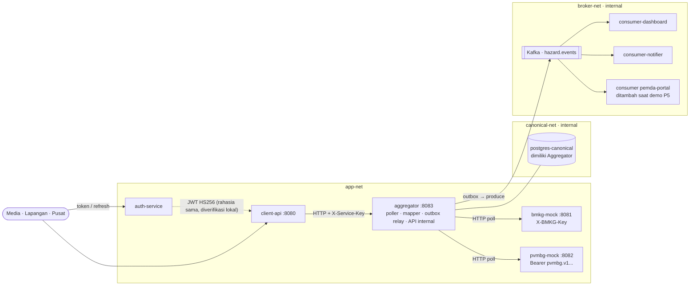

# Laporan IF4031 M1 — bagian umum (kerangka)

> **Catatan:** ini draf awal dalam Markdown. Laporan yang dikumpulkan adalah `docs/IF4031_M1_OrangSuksesAamiin.pdf` (sumber LaTeX di `docs/report/latex/`). Jika ada perbedaan, isi PDF yang berlaku.

> Kerangka bagian umum sesuai ketentuan laporan. Versi akhirnya ada di PDF yang dikumpulkan
> (`IF4031_M1_OrangSuksesAamiin.pdf`).

## 1. Sampul

Nama kelompok **OrangSuksesAamiin** · nama sistem **ARGUS (Aggregated Real-time Geohazard Unified System)** · IF4031 Arsitektur Aplikasi Terdistribusi,
Milestone 1 · anggota: 13523128 - Andi Farhan Hidayat, 13523164 - Muhammad Rizain Firdaus, 13523152 - Muhammad Kinan Arkansyaddad.

## 2. Tabel kontribusi

| Anggota | Perancangan | Implementasi | Laporan |
|---|---|---|---|
| Orang 1 | kontrak antar-komponen, arsitektur Aggregator, kebijakan skema | foundation (`pkg/obs`, compose, Makefile, CI), mock BMKG/PVMBG, Aggregator, P1, ketahanan ingest | bagian umum, P1, deskripsi mock |
| Orang 2 | Auth JWT (3 role), Client-Facing API :8080, kebijakan field Ringkasan/Mentah, rate limit, penanda `stale`; kontrak `contracts/openapi/client-api.yaml` | `services/auth-service`, `services/client-api`, `scripts/demo/p2.sh`, `p3.sh`, `scripts/loadtest/` | `docs/report/02-p2.md`, `docs/report/03-p3.md`; baris P2/P3 di `docs/traceability.md` |
| Orang 3 | perbandingan penyimpanan (PostgreSQL JSONB) dan distribusi event (Kafka dengan outbox), semantik pengiriman, batasan | skrip demo P4 dan P5, pengujian pemulihan consumer | Problem 4, Problem 5 |

## 3. Deskripsi umum sistem

Platform koordinasi kebencanaan yang menjembatani BMKG (gempa dan tsunami), PVMBG (gunung api) dan BNPB. Gateway BNPB
**mem-polling** kedua instansi (mock pasif), memetakan data ke format kanonik `HazardEvent`, menyimpannya di Canonical
Store, menerbitkan setiap perubahan ke broker, dan menyajikannya ke tiga jenis client (Media, Tim Lapangan, BNPB Pusat)
dengan hak akses berbeda. Lingkup M1: dua instansi, dua jenis bencana (seismik dan vulkanik), client read-only.

## 4. Arsitektur

**Narasi.** Polling berjalan di goroutine terpisah per sumber, terpisah dari jalur layanan: Client-Facing API tidak pernah
memanggil BMKG/PVMBG, sehingga PVMBG yang lambat atau mati tidak dapat menahan permintaan yang hanya butuh data BMKG (P2).
Aggregator adalah satu-satunya pemilik Canonical Store (jaringan `canonical-net` hanya berisi Aggregator dan database);
komponen lain membaca lewat API internal Aggregator (P4). Perubahan hazard ditulis bersama entri *outbox* dalam satu
transaksi, lalu relay menerbitkannya ke Kafka; consumer tidak diketahui producer, dan Kafka yang mati tidak menghentikan
ingest (P5). Setiap alur membawa correlation ID dari siklus poll hingga consumer. Kredensial setiap domain independen (P3).

## 5. Teknologi dan alasan

| Komponen | Teknologi | Alasan |
|---|---|---|
| Semua service | **Go** | konkurensi ringan (goroutine per sumber), image kecil dan build cepat (rebuild satu service, P4), tipe statis; satu bahasa menurunkan biaya integrasi |
| HTTP | `net/http` (Go 1.22 mux) | tanpa dependensi, cukup untuk routing dan middleware |
| Log | `log/slog` (JSON) | terstruktur, tanpa dependensi, correlation ID lewat context |
| Canonical Store | **PostgreSQL 16 + JSONB** | kolom tetap untuk identitas/field kanonik, `attributes JSONB` untuk yang dinamis → tanpa migrasi saat field baru muncul; query dan indeks kuat; transaksi untuk outbox |
| Broker | **Kafka (KRaft, 1 broker)** | log terdurable dengan replay dan consumer group (catch-up setelah consumer mati); urutan per key; jalur skala M2 |
| Klien Kafka | franz-go | Go murni (tanpa cgo) |
| Orkestrasi | Docker Compose, tiga jaringan (`app-net`, `canonical-net`, `broker-net`) | satu perintah; topologi jaringan menjadi bukti isolasi storage |
| Autentikasi klien | JWT HS256 (`golang-jwt`), refresh token opaque di SQLite (`modernc.org/sqlite`, Go murni) | TTL pendek dengan verifikasi lokal di Client-Facing API (jalur baca tidak bergantung pada Auth Service); refresh dapat dicabut per token |
| Pembatas laju | `golang.org/x/time/rate` (token bucket) | menolak kelebihan beban dengan 429 alih-alih mengantre (P2) |
| Load test | k6 | p50/p95/p99, throughput, error rate |
| Kualitas | GitHub Actions, gofmt/vet, `-race`, gitleaks | tes otomatis dan pencegahan kredensial ter-commit |

## 6. Asumsi

1. Respons mock berupa JSON array; `since` bersifat *strict greater-than* pada `occurred_at`/`issued_at`/`reported_at`
   (`issued_at` adalah field tambahan pada TsunamiWarning yang diizinkan).
2. Warning tsunami dapat terbit setelah event-nya (mock sengaja memberi jeda 2–8 detik); satu event dapat memiliki beberapa
   warning, yang tertinggi menentukan severity.
3. Satu instance Aggregator pada M1; konkurensi optimistis (`expectedVersion`) sudah menyiapkan M2.
4. Tabel referensi gunung api (`services/aggregator/config/volcanoes.json`) adalah data statis milik BNPB; koordinat adalah
   pendekatan untuk simulasi (bukan data resmi). Gunung "Prikitiw" bersifat fiktif.
5. Waktu di seluruh sistem adalah UTC; presisi HazardEvent dipotong ke mikrodetik.
6. Karantina rekaman yang tidak dapat dipetakan bersifat diagnostik dan tersimpan di memori.
7. Endpoint `/admin/*` pada mock (dan `extra_fields`, `override`, `/admin/generate`, `/admin/delay`) adalah tambahan untuk
   demo; tidak mengubah kontrak yang ditetapkan spesifikasi.
8. Semua client bersifat read-only; jalur pelaporan lapangan → BNPB di luar lingkup M1.

## 7. Petunjuk menjalankan

Ringkasan ada di `README.md` (langkah dari kondisi awal, daftar variabel, cara memicu tiap skenario). Singkatnya:
`cp .env.example .env && docker compose up --build`, lalu `make demo-p1` dan seterusnya.

## 8. Penggunaan AI

Penggunaan AI dideklarasikan pada surat pernyataan yang ditandatangani ketiga anggota. Surat itu terlampir di halaman
terakhir laporan PDF, dan berkas aslinya ada di `docs/report/latex/IF4031_Surat-Pernyataan-AI_OrangSuksesAamiin.pdf`.
