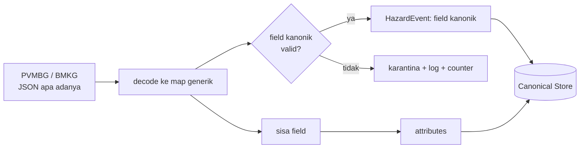

# Problem 1 — Arsitektur dan Interoperabilitas Data

> Draf bagian laporan. Bukti diambil dari `docs/evidence/p1/latest.log` (`make demo-p1`) dan test di
> `services/aggregator/internal/mapping/mapping_test.go`.

## 1. Rancangan solusi dan mekanisme

**Mekanisme: tolerant reader dengan kebijakan additive-only.** Aggregator tidak pernah mendekode data sumber ke
struct tetap. Setiap record di-decode ke peta generik (`map[string]any`), lalu:

1. **Field yang punya padanan kanonik** dibaca eksplisit dan divalidasi (wajib ada + tipe benar). Contoh: `magnitude`,
   `epicenter_lat/lon`, `occurred_at`, `alert_level`, `volcano_id`.
2. **Setiap field lain** — baik field kontrak yang hanya menjadi atribut (`depth_km`, `eruption_count_24h`, …) maupun
   field yang muncul kemudian (`confidence_level`, apa pun) — **diteruskan apa adanya ke `attributes`**.
3. **Record yang melanggar kontrak secara tak didukung** (field wajib hilang/berganti nama, tipe berubah, nilai enum baru)
   **tidak ditebak**: dikarantina (dicatat di log `mapping_rejected`, dihitung, dan terlihat di `GET /internal/quarantine`),
   sementara sisa batch tetap diproses dan watermark tetap maju.

   **Saat record yang sama diperbarui, `attributes` digabung secara aditif**: nilai yang dikirim sumber sekarang menang, tetapi
   field yang berhenti dikirim tetap tersimpan pada record itu. Tanpa ini, mengembalikan skema sumber (atau respons parsial)
   akan menimpa record terbaru, yang selalu ikut ter-fetch ulang oleh jendela overlap, dengan versi yang lebih miskin dan
   menghilangkan field yang sudah sempat ditangkap (bug ini sempat muncul saat pengujian; `TestSchemaRollbackDoesNotEraseCapturedFields`).

**Kebijakan field tak dikenal (dideklarasikan): DITERUSKAN ke `attributes`.** Konsistensi dijaga di satu tempat
(`splitExtras`) dan dibuktikan dua cara: `TestUnknownFieldPolicyIsConsistent` (semua tipe JSON, kedua sumber) dan demo
langsung: oracle di `p1.sh` memeriksa bahwa `attributes` **persis sama** dengan himpunan field sumber yang tidak punya
padanan kanonik (tidak ada yang hilang, tidak ada yang dikarang).

### Aturan pemetaan yang diterapkan

| Kanonik | SeismicEvent (BMKG) | VolcanicReport (PVMBG) |
|---|---|---|
| `hazard_id` | `bmkg-<event_id>` | `pvmbg-<report_id>` |
| `source_ref_id` | `event_id` | `report_id` |
| `hazard_type` | SEISMIC | VOLCANIC |
| `area_name` | `region_name` | nama dari tabel referensi statis BNPB (`config/volcanoes.json`) |
| `latitude`, `longitude` | `epicenter_lat/lon` | dari tabel referensi statis |
| `occurred_at` | `occurred_at` | `reported_at` |
| `severity` | lihat di bawah | `alert_level` (Normal/Waspada/Siaga/Awas → enum kanonik) |
| `attributes` | `magnitude`, `depth_km`, `potential_tsunami`, field TsunamiWarning terkait, + field tak dikenal | `eruption_count_24h`, `ash_column_height_m`, `confidence_level` bila ada, + field tak dikenal |

**Severity seismik**: AWAS bila ada warning `Awas`; selain itu mengikuti `threat_level` warning terkait; tanpa warning:
NORMAL (< 5,0), WASPADA (5,0 ≤ m < 6,5), SIAGA (≥ 6,5). Bila ada beberapa warning, yang tertinggi menang.

**Warning tsunami datang belakangan.** Warning diambil dari endpoint terpisah dan sering terbit setelah event-nya
tersimpan. Aggregator mengkorelasikannya lewat `related_event_id`, menghitung ulang severity, dan menyimpannya sebagai
**versi baru** (`version` naik, event `updated` diterbitkan). Warning yang eventnya belum terlihat menunggu (dibatasi TTL)
dan menahan watermark warning agar diambil ulang, bukan hilang. Karena `hazard_id` deterministik dan penyimpanan
membandingkan isi, polling ulang pada jendela overlap tidak menaikkan versi.

### Jenis perubahan skema

| Perubahan pada sumber | Perilaku | Didukung? |
|---|---|---|
| **Field baru** bertipe apa pun (`confidence_level`, objek bersarang, list, `null`) | masuk `attributes`, HazardEvent tetap valid | ✅ |
| Field baru pada TsunamiWarning | masuk `attributes` dengan prefiks `warning_` (mencegah tabrakan nama) | ✅ |
| Field yang hanya menjadi atribut menghilang (`depth_km`, `ash_column_height_m`, …) | atribut itu sekadar tidak ada | ✅ |
| Field baru lalu hilang lagi (skema dikembalikan) | record yang sudah tersimpan mempertahankan nilainya (`attributes` digabung aditif); record baru tidak memilikinya; tidak ada versi baru | ✅ |
| `volcano_id` tak ada di tabel referensi | `area_name` = id mentah, koordinat `null`, id disimpan di `attributes.volcano_id`, log peringatan | ✅ (degradasi) |
| **Field wajib hilang atau berganti nama** (`alert_level`, `volcano_id`, `magnitude`, …) | karantina | ❌ sengaja tidak |
| **Perubahan tipe** field wajib (`magnitude` jadi string) | karantina (tidak dipaksa/di-coerce) | ❌ sengaja tidak |
| **Nilai enum baru** (`alert_level: "Darurat"`, `threat_level` baru) | karantina | ❌ sengaja tidak |
| Perubahan semantik/satuan (mis. meter → kaki) | tidak terdeteksi | ❌ di luar jangkauan |
| Perubahan struktur endpoint (bukan array JSON, path berubah) | dianggap kegagalan sumber (breaker) | ❌ |

## 2. Alasan keputusan dan trade-off

| Alternatif | Kelebihan | Mengapa tidak dipilih |
|---|---|---|
| **Struct tetap** | sederhana, bertipe | field baru hilang diam-diam, atau `DisallowUnknownFields` menggagalkan seluruh pesan: persis masalah di soal |
| **Schema registry** | validasi terpusat, kompatibilitas terdefinisi | menuntut sumber ikut mendaftarkan skema; di soal PVMBG mengubah skema **tanpa memberi tahu siapa pun**, jadi registry tidak akan pernah diperbarui tepat waktu |
| **Protobuf/Avro (schema evolution)** | evolusi terformalisasi | sumber mengirim JSON, bukan format berskema; menambah lapisan konversi yang tetap harus tahu skema baru |
| **Dynamic mapping berbasis konfigurasi** (aturan pemetaan di file) | tanpa redeploy kode | tetap harus ada yang mengubah konfigurasi ketika field baru muncul; melanggar "tanpa intervensi manual" |
| **Tolerant reader + additive-only** ✔ | tanpa koordinasi, tanpa redeploy, perilaku deterministik dan mudah dibuktikan | konsekuensinya di §3 |

Alasan utama: sumber otonom dan tidak berkoordinasi, jadi mekanisme harus bekerja **sepihak dari sisi BNPB**. Perubahan
aditif adalah kelas perubahan yang paling umum dan paling aman untuk ditangani otomatis; perubahan yang mengubah arti
kontrak (rename, tipe, enum) sengaja dihentikan di pintu karena menebaknya berisiko salah menafsirkan data kebencanaan.
Di sisi penyimpanan, `attributes` adalah dokumen (JSONB), sehingga kebijakan ini tidak muncul kembali sebagai migrasi (P4).

## 3. Batasan yang disadari

- **Tipe nilai di `attributes` tidak divalidasi** (skemaless dengan sengaja). Perubahan tipe pada field atribut lolos apa adanya.
- **Field tak dikenal ikut diteruskan**, termasuk yang mungkin sensitif. Aman karena seluruh `attributes` berklasifikasi
  **Mentah**: Media tidak pernah menerimanya (ditegakkan Client-Facing API, P3).
- **Field yang sengaja dihapus sumber tetap menempel pada record lama** akibat penggabungan aditif (hanya record itu; record baru tidak memilikinya). Ini harga untuk tidak pernah membuang informasi.
- **Rename tidak dikenali sebagai rename**: field lama hilang (→ karantina bila wajib) dan field baru muncul sebagai atribut.
- **Perubahan semantik/satuan tidak terdeteksi**; tidak ada pemantauan drift selain log/counter karantina.
- **Karantina hanya di memori** (200 entri terakhir, counter sejak start): alat diagnosis, bukan penyimpanan resmi. Tidak
  ada fitur pemutaran ulang record yang dikarantina setelah kode diperbaiki (dapat ditambahkan di M2 bila perlu).
- Record ditolak diingat 15 menit agar polling ulang pada jendela overlap tidak menghitung/mencatat berulang.
- Pencocokan enum tak peka huruf besar/kecil (`SIAGA` dan `Siaga` sama); nilai lain ditolak.

## 4. Bukti penyelesaian

| Kriteria | Bukti |
|---|---|
| Skema awal → HazardEvent sesuai aturan pemetaan, kedua sumber | `make demo-p1` langkah 2: **oracle independen** membaca data mentah dari BMKG/PVMBG, menghitung sendiri HazardEvent yang diharapkan (severity, nama/koordinat, atribut) dan membandingkannya dengan isi Canonical Store: `PASS {"checked":N,"by_severity":{"AWAS":…,"NORMAL":…,"SIAGA":…,"WASPADA":…}}` (N = seluruh record sumber yang sudah masuk; keempat cabang severity terwakili oleh data seed) |
| Perubahan skema saat berjalan, tanpa restart | langkah 4: `POST /admin/schema-version`; langkah 5: `StartedAt` bmkg-mock, pvmbg-mock, aggregator **tidak berubah** |
| HazardEvent valid setelah perubahan, tanpa crash/intervensi | langkah 5: `attributes.confidence_level` dan field baru `lava_dome_volume_m3` muncul; oracle `PASS`; kedua sumber `up` |
| Record sebelum dan sesudah berdampingan | langkah 6: seluruh record lama (semua record vulkanik yang ada sebelum perubahan) tidak berubah (versi dan atribut identik); daftar memuat yang bertanda dan tidak bertanda `confidence_level` |
| Kebijakan konsisten | `TestUnknownFieldPolicyIsConsistent`; langkah 5 (diteruskan); langkah 7 (perubahan tak didukung → karantina, batch tidak terblokir) |
| Log ber-correlation ID dan latensi | langkah 8: satu `cid` melintasi `outbound_call` (dengan `latency_ms`) → `hazard_stored` → `poll_ok` → `outbox_published` |

Test terkait: `mapping_test.go` (tabel severity 4,99/5,0/6,49/6,5; warning terlambat; idempotensi; round-trip JSON),
`poller_test.go` (`TestPVMBGSchemaChangeWithoutRestart`, karantina tidak menahan watermark, dedup),
`pvmbg-mock/.../server_test.go` (skema awal vs baru), dan test kontrak JSON Schema di ketiga service.

## 5. Jawaban

- **Mekanisme yang dipilih**: *tolerant reader* dengan kebijakan *additive-only* (JSON dekode generik, field kanonik
  divalidasi eksplisit, sisanya diteruskan ke `attributes`), bukan schema registry atau Protobuf/Avro (alasan di §2).
- **Kebijakan field tak dikenal**: diteruskan ke `attributes` (tidak diabaikan).
- **Didukung**: penambahan field bertipe apa pun; hilangnya field yang hanya berstatus atribut; `volcano_id` baru
  (degradasi terkendali). **Sengaja tidak didukung** (→ karantina, batch berlanjut): penghapusan/penggantian nama field
  wajib, perubahan tipe field wajib, nilai enum baru; perubahan semantik/satuan tidak terdeteksi.
