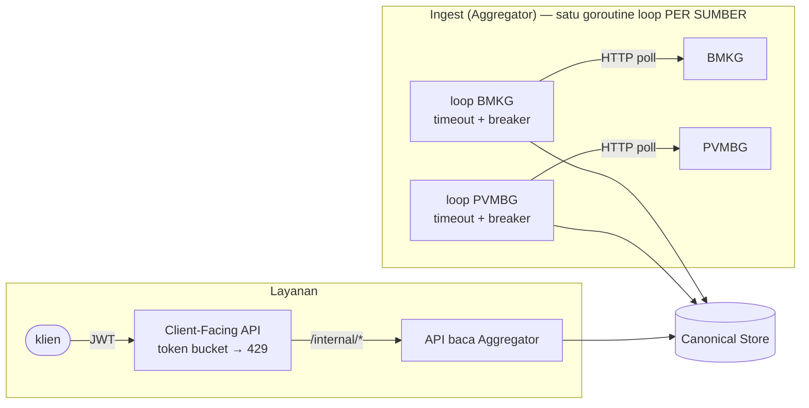

# Problem 2 — Concurrency, availability, dan graceful degradation (Orang 2; sisi ingest: Orang 1)

> Draf bagian laporan. Bukti: `make demo-p2-aggregator` (`docs/evidence/p2/aggregator-latest.log`), `make demo-p2`
> (`docs/evidence/p2/latest.log`, `k6-summary.json`, `k6-overload-summary.json`, `cid-trace.log`), dan test di
> `services/aggregator/internal/poller`, `resilience` serta `services/client-api/internal/{api,limit}`.

## 1. Rancangan solusi dan mekanisme

**Model konkurensi: ingest dan layanan dipisahkan sepenuhnya; jalur baca tidak pernah memanggil sumber.**



1. **Loop polling per sumber** (`aggregator/internal/poller/loop.go`): BMKG dan PVMBG masing-masing punya goroutine,
   timeout request (`SOURCE_TIMEOUT_SEC`), timeout siklus, dan *circuit breaker* (`resilience/breaker.go`: buka setelah N
   kegagalan beruntun, satu probe *half-open* setelah `BREAKER_OPEN_SEC`). Siklus berikutnya baru mulai `POLL_INTERVAL_SEC`
   setelah siklus sebelumnya selesai, sehingga sumber yang lambat tidak pernah menerima permintaan bertumpuk.
2. **Jalur layanan tidak memanggil BMKG/PVMBG sama sekali.** Client-Facing API membaca `GET /internal/*` Aggregator, yang
   membaca Canonical Store. Setiap permintaan klien dilayani oleh goroutine `net/http`-nya sendiri, jadi permintaan
   BMKG-only tidak berbagi antrean atau kunci dengan apa pun yang menunggu PVMBG.
3. **Pembatas laju (token bucket)** di Client-Facing API (`CLIENT_RATE_LIMIT_RPS/BURST`, default 500/1000): kelebihan
   beban ditolak **seketika** dengan `429` + `Retry-After`, tidak diantre. `/health` dan `/ready` dikecualikan agar probe
   tetap menjawab saat beban tinggi.
4. **Degradasi terkendali**: Aggregator menyimpan `freshness.{BMKG,PVMBG}` (`state`, `last_success_at`, `stale_since`). Saat PVMBG
   mati, data vulkanik terakhir tetap disajikan dari store; Client-Facing API menandai tiap item `stale: true` dan meneruskan
   `freshness.PVMBG.stale_since`. Tidak ada jalur yang mengubah matinya satu sumber menjadi 500 atau permintaan yang menggantung.

### Bagaimana model ini mencegah tiga kegagalan

| Kegagalan | Mekanisme |
|---|---|
| **Head-of-line blocking** | tidak ada rantai panggilan sekuensial BMKG→PVMBG: loop terpisah per sumber, dan permintaan klien hanya menyentuh store. PVMBG 3 detik tidak berada di jalur BMKG-only mana pun |
| **Resource exhaustion** | token bucket menolak kelebihan beban sebelum menyentuh Aggregator; timeout pada setiap panggilan keluar; breaker membuat sumber yang mati tidak menghabiskan goroutine/koneksi (polling dilewati, bukan ditumpuk) |
| **Tanpa degradasi terkendali** | data terakhir dari Canonical Store + `stale`/`stale_since`; sumber lain tetap segar |

## 2. Alasan keputusan dan trade-off

| Alternatif | Mengapa tidak dipilih |
|---|---|
| Panggil BMKG dan PVMBG **paralel per permintaan klien** (fan-out saat baca) | menghilangkan pemblokiran sekuensial, tetapi permintaan tetap menunggu PVMBG yang paling lambat (3 s) atau harus timeout; tiap lonjakan klien melipatgandakan beban ke sumber lama |
| **Cache di Client-Facing API** (TTL) | menyembunyikan masalah, bukan menyelesaikannya: data basi tanpa penanda; dua penyimpanan untuk satu fakta (melanggar "satu storage satu pemilik") |
| **Antrean + worker pool** untuk permintaan klien | membatasi konkurensi, tetapi menukar penolakan cepat dengan latensi yang membengkak (antrean mengisi memori) |
| **Semaphore konkurensi** (batas in-flight) alih-alih laju | melindungi dari permintaan lambat; di sini permintaan cepat (store lokal), sehingga laju adalah ukuran yang tepat |
| **Loop per sumber + store sebagai penyangga + token bucket** ✔ | terpisah secara struktural, perilaku saat gagal deterministik dan dapat didemokan |

Trade-off yang diterima: data yang dilayani **selalu** berasal dari store (eventual consistency sebesar interval polling,
3 s) dan kebijakan laju bersifat global (lihat §3).

## 3. Batasan yang disadari

- **Pembatas laju global**, bukan per klien, dan dipasang **sebelum** autentikasi: satu klien agresif (atau banjir tanpa token)
  dapat menghabiskan jatah klien lain. Cukup untuk membuktikan perlindungan sumber daya pada M1; per-klien adalah perbaikan M2.
- **Tidak ada batas jumlah koneksi bersamaan** selain laju; beban murni-koneksi lambat (slowloris) hanya dibatasi
  `ReadHeaderTimeout` 5 s.
- **Satu instance** Client-Facing API dan Aggregator; skala horizontal (pembatas laju terdistribusi) masuk M2.
- Penanda `stale` pada get-by-id membutuhkan satu panggilan tambahan ke `/internal/sources/status`.
- Data yang disajikan saat outage adalah snapshot terakhir; tidak ada estimasi/ekstrapolasi.
- Hasil load test berasal dari satu mesin (klien k6, Docker, dan semua service berbagi CPU Windows 11); angka absolut bukan
  klaim kapasitas produksi. Throughput k6 dibatasi *think time* 0,1 s per VU (≈450 req/s untuk 50 VU), bukan oleh server.

## 4. Konfigurasi dan tooling load test

| Item | Nilai |
|---|---|
| Tool | **k6** (biner lokal, atau `grafana/k6:0.54.0` via Docker bila tidak ada) |
| Skrip | `scripts/loadtest/p2.js`, dijalankan oleh `scripts/loadtest/run-p2.sh` (`make demo-p2` langkah E dan F) |
| Target | `GET /v1/hazards?hazard_type=SEISMIC&limit=20` pada Client-Facing API `:8080` (peran Lapangan) |
| **Sustained** | **50 VU konstan, 60 detik**, think time 0,1 s (`K6_VUS`, `K6_DURATION`, `K6_THINK_S`) |
| **Overload** | 150 VU, 20 detik, tanpa think time — sengaja melampaui batas laju (500 req/s) |
| Autentikasi | tiap VU login sendiri lalu memperbarui token lewat `POST /v1/refresh` 10 s sebelum `exp` (TTL 60 s). Versi awal memakai satu token untuk 60 s sehingga mengukur kedaluwarsanya sendiri sebagai galat |
| Klasifikasi | **200** = sukses; **429** = penolakan terkendali (dilaporkan, bukan galat); **tak tertangani** = selain keduanya (5xx, 401/403, timeout) |
| Ambang lulus | `unhandled < 1 %` dan `p95 < 300 ms` (k6 `thresholds`; `make demo-p2` gagal bila terlampaui) |
| Kondisi sistem | PVMBG delay 3 s diatur pada langkah A; seluruh stack dari `make reset` |

## 5. Bukti penyelesaian

Seluruh angka berasal dari run `make demo-p2` yang bukti mentahnya ada di `docs/evidence/p2/` (angka bervariasi sedikit antar-run; kriteria lulus-gagalnya ditegakkan skrip, bukan angka ini).

| Kriteria | Hasil | Bukti |
|---|---|---|
| **p95 BMKG-only < 300 ms saat PVMBG delay 3 s**, bersamaan dengan permintaan data PVMBG | 4 pembaca data vulkanik paralel + 40 permintaan BMKG-only: **p95 62,9 ms**, 0 galat (pembaca vulkanik p95 56–88 ms) | `latest.log` langkah A |
| **Load test ≥ 50 koneksi, ≥ 60 s, sustained** | 26.943 request, **448,3 req/s**, **p50 7,1 ms / p95 29,5 ms / p99 42,7 ms**, maks 68 ms; 200: 26.943, **429: 0**, lainnya: 0; **error tak tertangani 0 %** (< 1 %); 50 perpanjangan token berjalan di tengah uji | `k6-summary.json` |
| **Overload terkendali** | 189.082 request (≈9.400 req/s): 200: 10.989, **429: 178.093 (94,2 %)**, **lainnya: 0**; p95 37 ms; `/health` tetap 200 sesudahnya; tidak ada crash | `k6-overload-summary.json`, `latest.log` langkah F |
| **Outage PVMBG (`error`)**: seismik normal, vulkanik dari store + penanda kebaruan | 50 item vulkanik tetap tersaji, **semua `stale: true`**, `freshness.PVMBG.stale_since` terisi; pembacaan vulkanik p95 60,3 ms, 0 galat; event BMKG baru tetap masuk | `latest.log` langkah B; sisi ingest: `aggregator-latest.log` |
| **Outage `hang`** (tidak menjawab) | pembacaan seismik p95 34,3 ms; klien tidak menggantung | `latest.log` langkah C |
| **Pulih tanpa restart** | PVMBG kembali `up`, laporan baru ter-ingest, `StartedAt` lima container tidak berubah | `latest.log` langkah D |
| **Correlation ID lintas service** | satu `cid` melintasi `request` client-api → `outbound_call` (latensi 1,5 ms) → `request` aggregator | `cid-trace.log` |

Test terkait: `TestSlowSourceDoesNotBlockFastSourceAndCyclesNeverOverlap` (loop terpisah), `TestStaleMarkerWhenSourceIsDown`
(penanda `stale` untuk semua peran), `TestUpstreamDownIs503NotHang` (tanpa menggantung), `TestShedsExcessWith429ButKeepsHealthAlive`,
dan breaker (`resilience_test.go`).

## 6. Jawaban butir "Di laporan"

- **Model konkurensi yang dipilih**: loop polling terpisah per sumber (timeout + circuit breaker) yang menulis ke Canonical
  Store; jalur layanan hanya membaca store melalui API Aggregator, dengan token bucket di depan. Detail dan pemetaan ke tiga
  kegagalan: §1.
- **Konfigurasi dan tooling load test**: k6, 50 VU × 60 s (sustained) dan 150 VU × 20 s (overload), klasifikasi 200/429/tak
  tertangani, ambang `unhandled < 1 %` dan `p95 < 300 ms`: §4.

<!-- k6-metrics:auto:start -->

Snapshot dari `make demo-p2` (2026-10-07T19:47Z):

```json
{
  "config": {
    "vus": 50,
    "duration": "60s",
    "think_time_s": 0.1,
    "path": "/v1/hazards?hazard_type=SEISMIC&limit=20",
    "tool": "k6"
  },
  "requests": 26943,
  "throughput_rps": 448.34311161345096,
  "latency_ms": {
    "p50": 7.1427,
    "p95": 29.466699999999996,
    "p99": 42.69678199999998,
    "max": 68.3995
  },
  "status": {
    "ok_200": 26943,
    "rejected_429": 0,
    "other": 0
  },
  "rate_429": 0,
  "unhandled_error_rate": 0,
  "token_renewals": 50
}
```

<!-- k6-metrics:auto:end -->
