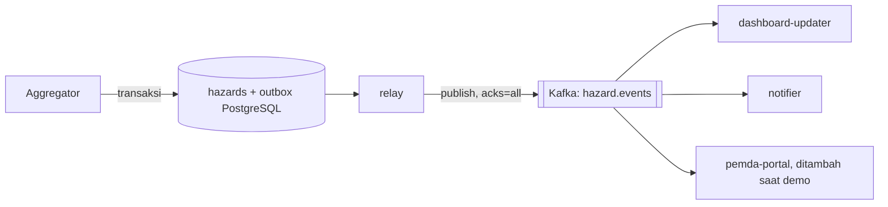

# Problem 5 — Fan-out distribusi event (Orang 3; producer/outbox awal: Orang 1)

> Bukti utama: `make demo-p5` → `docs/evidence/p5/latest.log`. Producer berada di
> `services/aggregator/internal/relay` dan `internal/adapters/kafka`; consumer berada di
> `services/consumer-hazard`.

## 1. Rancangan solusi dan mekanisme

Setiap `HazardEvent` baru atau versi baru yang berhasil disimpan menghasilkan satu entri **outbox** dengan
`event_id = hazard_id:version`. Hazard dan entri outbox ditulis dalam transaksi PostgreSQL yang sama.
Relay Aggregator membaca outbox secara berurutan, menerbitkan pesan ke topic Kafka `hazard.events`, menunggu
pengakuan broker (`acks=all`), lalu menandai entri sebagai terbit. Ketika Kafka tidak dapat dihubungi, entri
tetap berada di outbox untuk dicoba lagi. Aggregator tidak memanggil endpoint consumer.

Topic dibuat oleh `kafka-init`, bukan oleh producer saat publish. Key pesan adalah `hazard_id`, sehingga
urutan untuk hazard yang sama tetap berada dalam satu partisi. Header memuat `event_id` dan correlation ID
asal alur ingest. Retensi topic dikonfigurasi tujuh hari pada `.env.example` (`KAFKA_RETENTION_MS`), sehingga
consumer yang berhenti sementara dapat membaca pesan yang tertinggal selama masih berada dalam masa retensi.

`consumer-dashboard` dan `consumer-notifier` adalah container berbeda yang memakai image consumer yang sama,
tetapi consumer group berbeda (`dashboard-updater` dan `notifier`). Karena grupnya berbeda, keduanya menerima
event yang sama secara independen. Demo menambah consumer ketiga bernama `pemda` dengan group
`pemda-portal` melalui `docker compose run` saat sistem sudah berjalan. Producer dan topic tidak diubah.
Consumer membaca `event_id`, mencatat event yang diproses, dan menandai offset untuk commit setelah handler
selesai. Dashboard/notifier pada M1 berupa proof-of-concept penerima event; pengiriman notifikasi ke perangkat
nyata belum diimplementasikan.

## 2. Alasan keputusan dan trade-off

| Pilihan | Keuntungan | Mengapa dipilih/tidak dipilih |
|---|---|---|
| **HTTP langsung dari Aggregator ke tiap consumer** | Sedikit komponen awal | Producer harus mengetahui setiap consumer; consumer lambat menahan producer; menambah consumer memerlukan perubahan producer. Tidak dipilih |
| **Kafka + outbox (dipilih)** | Satu publish ke broker, consumer group independen, retensi dan replay, perubahan hazard + outbox atomik | Operasi broker lebih berat; single broker M1 belum tahan kegagalan node. Dipilih karena kriteria fan-out dan catch-up dapat dibuktikan |
| RabbitMQ dengan queue per consumer | Routing fan-out dan acknowledgement cukup langsung | Queue baru perlu pengikatan dan konfigurasi; pola replay berdasarkan rentang waktu tidak senatural log Kafka untuk skenario consumer menyusul |

Outbox dipakai karena menulis database lalu langsung memanggil Kafka tanpa transaksi bersama dapat menyisakan
hazard tanpa event ketika proses berhenti di antara dua langkah tersebut. Outbox menghindari celah itu, dengan
konsekuensi relay dapat mengirim pesan yang sama lebih dari sekali bila broker sudah menerima pesan tetapi
proses berhenti sebelum `published_at` dicatat.

## 3. Semantik pengiriman dan batasan

**Semantik sistem adalah at-least-once, bukan exactly-once.** Pesan bisa terbit lagi pada retry outbox atau
dibaca lagi bila consumer berhenti sebelum offset ter-commit. Karena itu consumer yang melakukan efek nyata
perlu idempoten terhadap `event_id` (`hazard_id:version`). Implementasi M1 menyimpan himpunan `event_id` yang
sudah diproses **di memori proses consumer** dan mengabaikan duplikat selama proses itu hidup.

Batasan yang perlu dibedakan dari klaim idempotensi penuh:

- Himpunan deduplikasi hilang ketika consumer restart. Bila Kafka mengirim ulang event yang sudah diproses
  sebelum restart, efek eksternal seperti notifikasi nyata belum aman dari duplikasi. Sebelum menambah efek
  semacam itu, consumer harus menyimpan `event_id` secara durabel bersama status efeknya, atau memakai
  transactional outbox milik consumer.
- Demo consumer hanya mencatat event/log dan statistik; tidak mengirim notifikasi nyata atau memperbarui
  dashboard eksternal. Deduplikasi memori cukup untuk perilaku proof-of-concept yang diperagakan, bukan
  jaminan untuk produk operasional.
- Kafka memakai satu broker pada M1. Retensi default tujuh hari membatasi periode catch-up; event yang sudah
  melewati retensi tidak dapat diambil kembali. Urutan dijamin per key/partisi, bukan urutan global seluruh
  hazard.
- Consumer menandai offset setelah handler dipanggil. Pesan yang tidak dapat dibaca sebagai envelope valid
  dicatat sebagai `consumer_bad_message` dan juga dilewati; belum ada dead-letter topic atau pemulihan
  otomatis untuk pesan rusak.

## 4. Bukti penyelesaian

| Kriteria | Hasil yang tercatat | Bukti |
|---|---|---|
| Event baru masuk broker, bukan dikirim langsung ke consumer | Demo menunggu log `outbox_published` untuk event yang dibuat, lalu masing-masing log `consumer_event`; relay memanggil Kafka publisher dengan acknowledgement broker | `docs/evidence/p5/latest.log` langkah B–E; `relay.go`, `kafka/publisher.go` |
| Dua consumer independen menerima stream yang sama | Langkah B membuat satu event BMKG; dashboard dan notifier dengan group terpisah sama-sama memproses `bmkg-EQ-9b73f8-0061:1` | `docs/evidence/p5/latest.log`, langkah A–B; `docker-compose.yml` |
| Satu consumer mati; producer dan consumer lain terus berjalan | Langkah C menghentikan notifier, lalu Aggregator menyimpan serta menerbitkan `bmkg-EQ-9b73f8-0063:1` dan dashboard menerimanya | `docs/evidence/p5/latest.log`, langkah C |
| Consumer menyusul setelah hidup kembali | Langkah D memulai notifier dan memeriksa **ID event yang tepat** (`bmkg-EQ-9b73f8-0063:1`) di log notifier, bukan hanya kenaikan penghitung | `docs/evidence/p5/latest.log`, langkah D |
| Consumer baru ditambah tanpa perubahan producer | Langkah E menjalankan `pemda-portal` sebagai group baru pada topic yang sama; dashboard, notifier, dan pemda menerima `bmkg-EQ-9b73f8-0065:1`. ID container dan `StartedAt` Aggregator tetap | `docs/evidence/p5/latest.log`, langkah E; `scripts/demo/p5.sh` |

## 5. Jawaban

Broker yang dipilih adalah **Kafka**, dengan satu topic dan consumer group terpisah per tujuan. Outbox
transaksional dan relay memisahkan penyimpanan hazard dari ketersediaan broker; Kafka memisahkan producer
dari jumlah dan kecepatan consumer. Semantiknya **at-least-once**, sehingga duplikasi mungkin terjadi.
Consumer perlu idempoten berdasarkan `event_id`. Pada M1, duplikasi disaring selama satu proses hidup;
untuk efek nyata yang harus aman melewati restart, penyimpanan idempotensi durabel diperlukan seperti
dijelaskan di §3.
