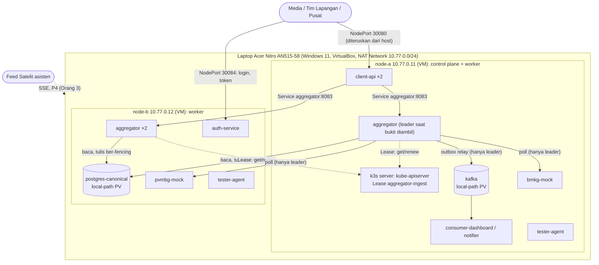

# Bagian umum M2 (Orang 1: deployment, perubahan dari M1, topologi)

> Draf. Bagian lain bagian umum (sampul, kontribusi, teknologi, asumsi, Form Penggunaan AI) mengikuti format M1.

## Diagram deployment

Penempatan di atas adalah penempatan aktual di cluster demo saat bukti diambil (14 Nov 2026,
`kubectl get pods -o wide`). Leader bisa berpindah ke instance Aggregator mana pun. Penempatan bergantung pada scheduler.
Yang dijamin manifest:

- Aggregator tersebar dengan selisih maksimal satu per node (`topologySpreadConstraints`).
- Data `role=store` dan `role=broker` tersimpan di disk node tempat pod berjalan (local-path PV, jadi pod itu terikat ke
  node tersebut).
- Ada satu Tester Agent per node.

`make k8s-status` menunjukkan penempatan terkini. Jalur data antar-node lewat Service (kube-proxy) dan DNS cluster.
Canonical Store dan Kafka hanya menerima koneksi dari pod yang diizinkan NetworkPolicy. Canonical Store kini satu instance
di node-b. Penyebaran replikanya ke beberapa node menjadi bagian P1 (Orang 3).

## Perubahan dari M1

| Keputusan M1 | M2 | Alasan |
|---|---|---|
| `docker compose`, satu host | **Diubah**: Kubernetes (k3s), manifest `deploy/`, satu perintah `make k8s-up`; compose tetap untuk pengembangan | Ketentuan M2; banyak node, rolling update, self-healing |
| Isolasi storage lewat jaringan Docker internal | **Diubah**: NetworkPolicy + Secret per komponen | Sama tujuannya, ditegakkan platform di cluster |
| Satu Aggregator yang polling | **Diubah**: ≥ 3 instance; satu leader (Lease) yang ingest, semua melayani baca; fencing token di store | P2: tanpa ini tiap kejadian diambil tiga kali |
| Status sumber di memori Aggregator | **Diubah**: disimpan leader di store, dibaca semua instance | Instance yang tidak polling harus memberi freshness yang sama |
| Karantina di memori, `GET /internal/quarantine` dengan service key | **Diganti**: dead-letter store persisten (raw bytes, retrying/parked), hanya untuk Internal Ops | P3: pesan gagal harus tersimpan utuh dan dapat diproses ulang; hanya Ops yang boleh melihat |
| Parser JSON standar untuk seluruh respons | **Diganti**: pemecah array streaming per elemen dengan batas ukuran/kedalaman | P3: satu pesan rusak tidak boleh menjatuhkan batch atau proses |
| Kebijakan skema additive-only, perubahan tak didukung dikarantina | **Dipertahankan**, ditambah aturan penyesuaian deklaratif (`rename`, `coerce`) | Tetap tidak menebak; manusia memutuskan, sistem memproses ulang |
| Outbox transaksional + relay, Kafka at-least-once | **Dipertahankan**; relay hanya di leader; outbox mencatat `writer_term` | Audit siapa menulis apa per term |
| Circuit breaker dan polling per sumber | **Dipertahankan** (dijalankan per masa kepemimpinan) | |
| Admin mock wajib `X-Admin-Token` | **Diubah di k8s**: boleh tanpa token (`*_ADMIN_OPEN`), token salah tetap ditolak; Service mock hanya ClusterIP | Tester Agent memanggil `/admin/*` tanpa kredensial kelompok |
| Kredensial independen per instansi | **Dipertahankan**; ditambah `AGGREGATOR_OPS_TOKEN`, `AUDIT_TOKEN`, `SATELLITE_FEED_TOKEN` | |

## Deklarasi topologi

Lihat README §M2.1 (diisi dari cluster demo dengan `bash scripts/k8s/topology.sh` ditambah host fisik dan spesifikasinya).
