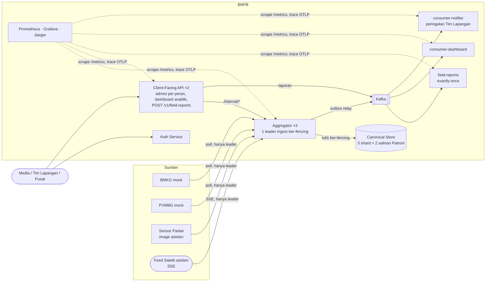
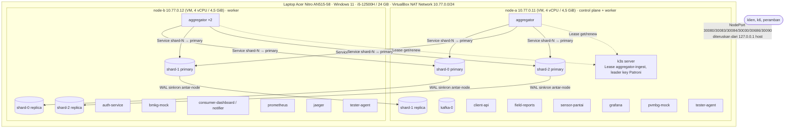

# Bagian Umum

## Tabel kontribusi

| Anggota | Perancangan | Implementasi | Penulisan laporan |
|---|---|---|---|
| 13523128 – Andi Farhan Hidayat (Orang 1) | Platform Kubernetes, satu penulis ber-fencing, kebijakan skema dan DLQ, integrasi akhir | Manifest k8s dan satu perintah deploy, cluster VirtualBox, leader election + fencing (P2), DLQ dan mode skema tidak kompatibel (P3 kriteria 1–5), Audit `unprocessed`; integrasi M2: storage sharded di 2 node, `balance-shard`, metrik penempatan dan feed, demo P1/P5 game day, gladi penuh di k3s | Bagian umum, P2, P3 (1–5), penyuntingan P1 dan P4, penyusunan PDF |
| 13523164 – Muhammad Rizain Firdaus (Orang 2) | Observabilitas, jalur laporan Tim Lapangan, ketahanan Sensor Pantai, admisi per peran | `pkg/obs` (metrik Prometheus, trace W3C), Grafana/Prometheus/Jaeger, `POST /v1/field-reports` + pemroses exactly-once (P3 kriteria 6), Sensor Pantai (P5), dashboard analitik (P1 kriteria 7), load test k6, HPA | Observabilitas, P3 kriteria 6, P5, P1 kriteria 7, konfigurasi load test |
| 13523152 – Muhammad Kinan Arkansyaddad (Orang 3) | Canonical Store terdistribusi (Patroni per shard), Audit API, pemrosesan aliran satelit | Adapter `sharded`, migrasi store tunggal → sharded, Audit `events`/`checksum`/`location`, consumer SSE Feed Satelit dan pengelompokan kebakaran (P4), cluster QEMU 3 node | Draf P1 dan P4 |

## Deskripsi umum sistem

ARGUS adalah gateway kebencanaan BNPB yang menyatukan beberapa sumber ke satu format **HazardEvent**:
- BMKG (gempa, peringatan tsunami);
- PVMBG (gunung api);
- Feed Satelit (titik panas → kebakaran hutan);
- Sensor Pantai (pengamatan pesisir).

Setiap HazardEvent disimpan di **Canonical Store**, yang hanya dimiliki Aggregator. Event diterbitkan ke Kafka lewat
outbox, lalu disajikan kepada Media, Tim Lapangan, dan BNPB Pusat sesuai hak masing-masing.

M2 menjalankan sistem yang sama di Kubernetes dengan dua node berkernel terpisah. Perubahannya:
- Canonical Store dibagi menjadi 3 shard yang direplikasi ke node lain.
- Aggregator berjalan ≥ 3 instance di belakang satu Service, dan hanya satu leader ber-fencing yang mengambil data.
- Pesan yang gagal disimpan utuh di dead-letter store.
- Feed Satelit dibaca sebagai aliran SSE dengan offset.
- Sensor Pantai diisolasi dengan bulkhead dan circuit breaker.
- Tim Lapangan dapat mengirim laporan yang dijamin diproses tepat sekali.

## Diagram arsitektur

## Daftar teknologi terpilih

| Bagian | Teknologi | Alasan singkat |
|---|---|---|
| Bahasa service | Go 1.25 (`net/http`, `log/slog`) | Biner statis kecil, cocok dengan limit memori Lampiran B |
| Orkestrasi | k3s v1.37 di 2 VM VirtualBox (Ubuntu 24.04) | Ringan; NetworkPolicy, Lease, local-path PV bawaan |
| Canonical Store | PostgreSQL 16 + JSONB, Patroni 4.1 per shard (DCS = API Kubernetes) | Transaksi untuk outbox + fence; replikasi sinkron dan failover tanpa etcd tambahan |
| Broker | Kafka (KRaft), transaksi untuk field reports | Log berurutan, consumer group, exactly-once producer |
| Koordinasi leader | Lease `coordination.k8s.io` + fencing token di store | Jam kebenaran = API server, bukan jam node |
| Observabilitas | Prometheus, Grafana, Jaeger (OTLP), log JSON ber-`cid` | Satu dashboard, trace lintas service |
| Load test | k6 (di host, di luar pod) | 10.000 VU, skenario ber-peran |
| Uji ketahanan | Tester Agent asisten (image dipin digest) | Ketentuan M2 |

## Asumsi

- Semua node berada dalam satu jaringan dengan latensi rendah (VirtualBox NAT Network). Bonus host fisik berbeda tidak
  diambil.
- Data `role=store` cukup disimpan di disk lokal node (local-path PV); tidak ada backup ke luar cluster.
- Katalog gempa dari asisten belum diterima saat bukti diambil. P1 memakai katalog sintetis yang meniru kemiringan
  wilayah (`tools/catalog/catalog.py`). Katalog asli dapat dimuat tanpa perubahan kode.
- `AUDIT_TOKEN`, kunci skenario ujian, dan token sesi ujian baru diberikan setelah tenggat. Bukti di laporan ini memakai
  token pengembangan dan skenario practice; hasil ujian ditunjukkan di video.

## Petunjuk menjalankan

README §M2 berisi langkah lengkap dari kondisi awal, daftar variabel konfigurasi, dan cara memicu setiap skenario.
Ringkasannya ada di Lampiran A. Intinya: `bash scripts/k8s/vbox-cluster.sh up`, `cp .env.example .env`, lalu
`make k8s-up`.

## Diagram deployment

Penempatan stateless (aggregator, client-api, consumer, observabilitas) ditentukan scheduler dan dapat berbeda di setiap
deploy. `make k8s-status` dan `kubectl get pods -o wide -L role,db-role` menunjukkan keadaan terkini. Yang **dijamin**
manifest:
- Dua salinan setiap shard berada di node berbeda (pod anti-affinity wajib).
- Primary pilihan tiap shard dirotasi di node (ConfigMap `shard-placement`, dikembalikan oleh `balance-shard`).
- Aggregator tersebar dengan selisih ≤ 1 per node (`topologySpreadConstraints`).
- Data `role=store` dan `role=broker` disimpan di disk node (local-path PV).
- Tester Agent berjalan satu per node.

Jalur data antar-node: replikasi WAL Patroni (5432) antar anggota shard, Service → primary shard, kube-proxy untuk
Service lain, dan Lease/Endpoints lewat API server di node-a. NetworkPolicy hanya mengizinkan Aggregator (dan Job
migrasi) membuka koneksi ke store, dan hanya klien Kafka berlabel yang boleh ke broker.

## Perubahan dari M1

| Keputusan M1 | M2 | Alasan |
|---|---|---|
| `docker compose`, satu host | **Diubah**: Kubernetes (k3s), manifest `deploy/`, satu perintah `make k8s-up`; compose tetap untuk pengembangan | Ketentuan M2; banyak node, rolling update, self-healing |
| Satu PostgreSQL sebagai Canonical Store | **Diubah**: 3 shard Patroni × 2 salinan di node berbeda, hash `hazard_id`; migrasi online `MIGRATE_CANONICAL=1` | P1: tidak muat di satu tempat, harus tahan kehilangan node |
| Isolasi storage lewat jaringan Docker internal | **Diubah**: NetworkPolicy + Secret per komponen | Ditegakkan platform di cluster |
| Satu Aggregator yang polling | **Diubah**: ≥ 3 instance; satu leader (Lease) yang ingest, semua melayani baca; fencing token di setiap shard | P2: tanpa ini tiap kejadian diambil tiga kali |
| Polling untuk semua sumber | **Dipertahankan** untuk BMKG/PVMBG/Sensor Pantai; **tidak dipakai** untuk Feed Satelit (SSE + offset) | P4 §2 |
| Status sumber di memori Aggregator | **Diubah**: disimpan leader di store, dibaca semua instance | Freshness yang sama di setiap instance |
| Karantina di memori | **Diganti**: dead-letter store persisten (raw bytes, retrying/parked), hanya untuk Internal Ops | P3 |
| Parser JSON standar | **Diganti**: pemecah array streaming per elemen dengan batas ukuran/kedalaman | P3: satu pesan rusak tidak menjatuhkan batch |
| Kebijakan skema additive-only, perubahan tak didukung dikarantina | **Dipertahankan**, ditambah aturan penyesuaian deklaratif (`rename`, `coerce`) | Tetap tidak menebak |
| Outbox transaksional + relay, Kafka at-least-once | **Dipertahankan**; outbox ikut shard hazard-nya, relay hanya di leader | Audit siapa menulis apa per term |
| Client API hanya baca | **Diubah**: `POST /v1/field-reports` (202 setelah Kafka mengonfirmasi), admisi per peran | P3 kriteria 6, P5 kriteria 5 |
| Log JSON ber-`cid` | **Dipertahankan**, ditambah metrik Prometheus dan trace W3C | Observabilitas M2 |
| Admin mock wajib `X-Admin-Token` | **Diubah di k8s**: boleh tanpa token (`*_ADMIN_OPEN`), Service mock hanya ClusterIP | Tester Agent memanggil `/admin/*` tanpa kredensial |

## Deklarasi topologi

| Node | Peran | Jenis | vCPU / RAM | OS / kernel | Host fisik | CPU / RAM host |
|---|---|---|---|---|---|---|
| node-a (10.77.0.11) | control plane + worker | VM VirtualBox 7.1.4 | 4 / 4,5 GiB, disk 10 GB | Ubuntu 24.04.5, 6.8.0-147, k3s v1.37.2 | Laptop Acer Nitro AN515-58, Windows 11 Home | Intel Core i5-12500H (12 core / 16 thread) / 24 GB |
| node-b (10.77.0.12) | worker | VM VirtualBox 7.1.4 | 4 / 4,5 GiB, disk 10 GB | idem | laptop yang sama | sama |

Kedua node berkernel terpisah (boot id berbeda, `docs/evidence/m2/topology.log`). Skenario mematikan node hanya dikenakan
pada node-b (worker non-control-plane).

## Observabilitas

Setiap service BNPB memakai `pkg/obs`, sehingga ketiga syarat observabilitas berlaku seragam tanpa kode per service:

1. **Metrik dalam satu dashboard.** Setiap service melayani `GET /metrics`: jumlah, latensi (histogram) dan status per
   route, panggilan keluar per tujuan, serta metrik domain. Metrik domain mencakup status sumber dan breaker, leader dan
   term, outbox, DLQ, Sensor Pantai, admisi per peran, laporan lapangan, consumer, penempatan unit penyimpanan per node,
   beban tulis per shard, serta lag dan latensi Feed Satelit. Prometheus menemukan setiap pod sendiri, dan Grafana
   menampilkan satu dashboard "Argus / Observabilitas" (`:30030`).
2. **Trace satu permintaan lintas service.** Konteks W3C `traceparent` dibawa lewat HTTP dan header Kafka, lalu diekspor
   ke Jaeger (`:30686`). Durasi tiap langkah terlihat, misalnya client-api → aggregator → store, client-api → Kafka →
   field-reports, dan poll → upstream → store → outbox → Kafka → consumer.
3. **Log terstruktur ber-correlation ID.** Format log M1 dipertahankan, dengan tambahan `trace_id`.

`pkg/obs` tanpa dependensi pihak ketiga: registry Prometheus dan exporter OTLP/HTTP JSON ditulis sendiri, agar tidak ada
SDK yang menambah memori pod (Lampiran B). Komponen observabilitas di-deploy dengan `role=other` dan 128/256 Mi. Demo:
`make demo-m2-observability`.

**Bukti.** Demo otomatis `make demo-m2-observability` lulus di cluster pengembangan kind (`docs/evidence/m2/observability-kind.log`):
metrik setiap service ter-scrape, satu trace lintas service dengan durasi tiap langkah, serta `cid` dan `trace_id` di log.
Di cluster demo k3s, Grafana (`:30030`, NIC host-only `192.168.56.11`), Prometheus, dan Jaeger berjalan dan menampilkan
baris dashboard baru untuk penempatan storage (P1) dan ketertinggalan Feed Satelit (P4). Demo otomatisnya tidak diulang
di k3s karena waktu. Tampilan langsung ditunjukkan di video.
