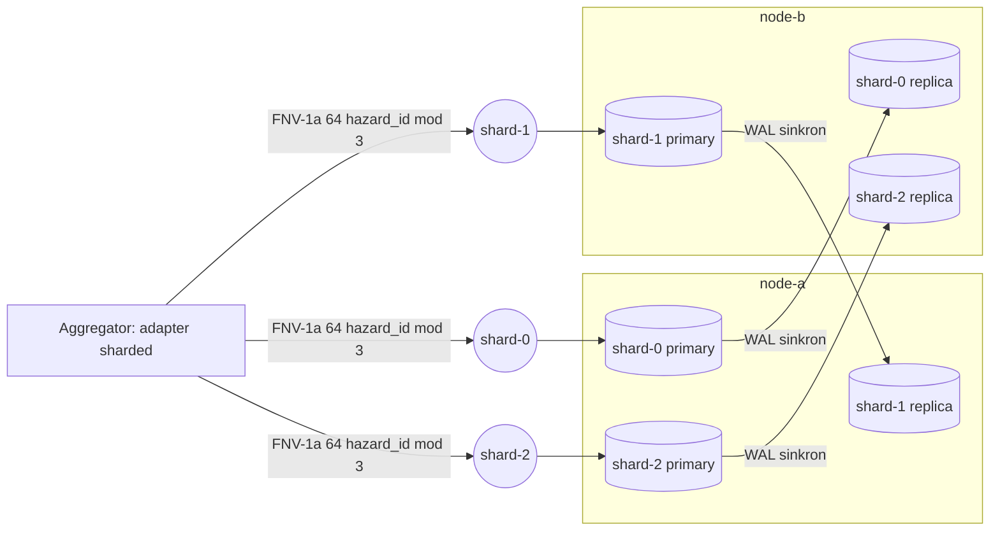

# Problem 1 — Yang Pulang Membawa Laptopnya

## 1. Identifikasi masalah (butir "Di laporan" 1)

| Persoalan | Nama dan konsep dalam literatur |
|---|---|
| Data tidak muat di satu penyimpanan dan harus dibagi | **Partitioning / sharding** (Kleppmann, *DDIA* bab 6): setiap record punya tepat satu partisi pemilik. |
| Gempa terkonsentrasi di satu jalur sehingga satu mesin bekerja keras | **Data skew** dan **hot spot / hot partition**. Partisi menurut kunci yang berkorelasi dengan wilayah atau waktu menumpuk beban di satu partisi. |
| Laptop pulang membawa sebagian catatan | **Replication** untuk *durability* dan *availability*: *single-leader (primary–backup) replication* dengan *synchronous standby*, **failover**, dan bahaya **split-brain**. |
| Laptop baru harus masuk tanpa mematikan sistem | **Rebalancing**: memindahkan salinan dan peran primary ke node baru secara online (*re-replication*, *planned switchover*). |
| Membaca lintas lokasi selama sebagian unit hilang | **Scatter–gather** dengan batas waktu per unit; **degraded / partial results** (*harvest vs yield*, Fox & Brewer 1999); trade-off konsistensi–ketersediaan (**CAP/PACELC**). |

## 2. Mekanisme yang dipilih (butir "Di laporan" 2)

**Unit penyimpanan.** Canonical Store dibagi menjadi tiga shard logis. Setiap shard adalah satu grup Patroni dengan dua
anggota PostgreSQL 16. Kedua anggota berada di node berbeda karena *pod anti-affinity* wajib. Datanya berada di disk
node lewat PV `local-path`. Setiap anggota berlabel `role=store`, dengan requests 512Mi dan limits 1Gi (Lampiran B).

**Di mana sebuah data disimpan.** Aggregator, satu-satunya pemilik store, menghitung `FNV-1a 64(hazard_id) mod 3`.
Baris outbox ikut shard hazard-nya dan ditulis dalam transaksi yang sama.
Metadata bersama (cursor polling, status sumber, DLQ, checkpoint satelit) berada di shard-0. Shard logis sebuah hazard
**tidak pernah berubah** ketika node datang dan pergi. Yang berpindah hanyalah lokasi fisik salinan dan peran primary.
Akibatnya, rebalancing tidak menyalin ulang data antar-shard. Cara ini berbeda dari *consistent hashing* atas node,
yang memindahkan kunci saat keanggotaan berubah.

**Siapa primary.** Patroni menyimpan *leader key* tiap shard di API Kubernetes. Ini sumber kebenaran yang sama dengan
lease leader Aggregator pada P2, sehingga keputusan primary tidak bergantung pada jam node. Commit menunggu WAL
tersimpan di standby (`synchronous_mode: true`). Bila primary hilang, standby sinkron yang dipromosikan; salinan usang
tidak pernah dipromosikan. Bila standby yang hilang, primary tetap menerima tulis dengan satu salinan (mode sinkron
non-strict). Pilihan ini menukar perlindungan terhadap kehilangan **kedua** selama perbaikan dengan ketersediaan tulis.

**Sebaran beban tulis.** ConfigMap `shard-placement` menetapkan node pilihan primary tiap shard, dirotasi di node
penyimpanan (2 node: shard-0 → node-a, shard-1 → node-b, shard-2 → node-a). `balance-shard` berjalan di setiap anggota
dan hanya berbicara dengan API Patroni lokal. Bila leader tidak di node pilihannya, dan anggota di node pilihan sudah
`sync_standby`, *streaming*, lag 0, serta stabil 60 s, leader meminta **switchover terencana**. Tidak ada data hilang
karena kandidatnya sinkron. Ada jeda 300 s antar-switchover untuk mencegah *flapping*. Saat cluster dideploy, ketiga
primary mula-mula terpilih di node-b. Satu menit kemudian `balance-shard` memindahkan primary shard-0 dan shard-2 ke
node-a tanpa intervensi (log: `"switchover requested" … "Successfully switched over to \"shard-0-1\""`).

**Ketika node datang dan pergi.**
- **Node hilang:** anggota di node lain menjadi primary (failover Patroni). Pembacaan dan tulisan pindah ke sana.
- **Node kembali kosong / node baru:** anggota yang PV-nya kosong dibangun ulang otomatis oleh Patroni (`basebackup`
  dari primary, lalu *streaming*). Setelah sinkron, `balance-shard` mengembalikan primary ke node pilihan, sehingga node
  itu ikut menanggung tulisan. Untuk node pengganti bernama lain, `scripts/k8s/restore-shard.sh` memindahkan klaim PV
  ke node baru.
- **Fencing P2 tetap berlaku di setiap shard.** `RaiseFence` menaikkan term di semua shard, dan setiap tulisan memeriksa
  fence di transaksinya sendiri.

## 3. Alternatif dan konsekuensinya pada kriteria 2 (butir "Di laporan" 3)

Ketiga strategi diukur offline pada input yang **sama** dengan yang dimuat ke cluster: katalog 5.000 gempa dengan
kemiringan alami (Sumatera Barat terbanyak) ditambah lonjakan 1.500 gempa di Sumatera Barat. Penempatannya dihitung
oleh `tools/catalog/catalog.py distribution` (`docs/evidence/m2/p1-load-latest.log` §5).

| Strategi (3 shard) | Seluruh data: baris per shard | max/mean | Tulisan 24 jam terakhir (lonjakan) | max/mean |
|---|---|---|---|---|
| **Hash `hazard_id` (dipilih)** | 2151 / 2178 / 2171 | **1,01** | 491 / 509 / 500 | **1,02** |
| Range per `area_name` | 1897 / 1298 / 3305 | 1,53 | 0 / 0 / 1500 | 3,00 |
| Range per `occurred_at` (potongan kuantil) | 2166 / 2167 / 2167 | 1,00 | 0 / 0 / 1500 | 3,00 |

- **Range per wilayah:** query per wilayah murah (satu shard), tetapi wilayah teraktif menjadi *hot partition*
  permanen. Seluruh lonjakan Sumatera Barat jatuh ke satu shard.
- **Range per waktu:** seimbang untuk data historis dan *range scan* waktu efisien, tetapi **semua tulisan baru** selalu
  menuju partisi terbaru (*write hotspot*).
- **Hash (dipilih):** tulisan tersebar rata, termasuk saat lonjakan. Konsekuensinya, setiap query lintas wilayah atau
  waktu harus *scatter–gather* ke semua shard lalu di-*merge*, dan locality per wilayah hilang.

**Sebaran per node** mengikuti letak primary. Dengan 3 shard di 2 node, node-a memegang 2 primary, sehingga beban tulis
terukur 71 % node-a / 29 % node-b, baik saat katalog dimuat (+4.099 / +1.700 tulisan) maupun saat lonjakan
(+1.244 / +519). Ketidakseimbangan ini disebabkan jumlah shard yang tidak habis dibagi jumlah node, bukan oleh
kemiringan data. Dengan 3 node, atau 4 shard di 2 node, pembagiannya rata.

## 4. Jaminan konsistensi per endpoint (butir "Di laporan" 4)

| Endpoint | Kondisi normal | Selama node hilang | Alasan |
|---|---|---|---|
| Tulis (ingest, satu leader) | Linearizable per hazard: versi + fence dalam satu transaksi di primary, durable di 2 node sebelum ack | Tetap linearizable per hazard setelah failover; ack hanya durable di 1 node sampai replica kembali | Primary tunggal per shard (leader key di API Kubernetes), standby sinkron, fence term |
| `GET /internal/hazards`, `/v1/hazards` (50 terbaru, pagination) | Urutan global `(occurred_at, hazard_id)` menurun yang benar; keyset cursor stabil | Shard yang tidak menjawab dalam 1,2 s dilewati: jawaban **partial** dengan `partial: true` + `unavailable_units` (bukan 500, bukan menggantung) | Scatter–gather ber-deadline; *harvest* dikorbankan demi *yield* |
| `GET /internal/hazards/{id}` | Read-your-writes dari primary pemilik | 503 bila shard pemilik tidak terjangkau; 404 hanya bila ketiadaan dapat dipastikan | Ketiadaan tidak boleh ditebak |
| `GET /internal/audit/events` | Urutan menaik `(ingested_at, hazard_id)`, cursor opaque | `partial: true` dengan nama unit; cursor yang sama dipakai ulang setelah pulih | Sama dengan di atas |
| `GET /internal/audit/checksum` | SHA-256 atas `source_ref_id` aktif, satu snapshot per shard | Digest parsial dengan daftar unit | Snapshot per shard; antar-shard tidak atomik |
| `GET /internal/audit/location` | Node dan peran tiap salinan, diverifikasi langsung ke setiap anggota | Hanya salinan terverifikasi, `partial: true` | Peran dibaca dari `pg_is_in_recovery()` di anggota itu sendiri |
| Dashboard analitik | Angka = hitungan Audit API pada potongan `ingested_at` yang sama | Banner "BELUM LENGKAP" + tanda `+` | Lihat §7 |

## 5. Bukti per kriteria

| Kriteria | Bukti (cluster k3s 2 VM, 22 Nov 2026) | Hasil |
|---|---|---|
| 1. Data dipartisi; tidak ada unit memuat semua; primary di > 1 node; laporan sebaran | `make demo-m2-p1-load` → `p1-load-latest.log`; Grafana baris "P1"; `audit/location` | 8.431 event aktif; per unit 2.790 / 2.819 / 2.821 baris (primary sama dengan replica-nya); primary shard-0 dan shard-2 di node-a, shard-1 di node-b; setiap shard punya replica di node lain. **PASS** |
| 2. Ketidakmerataan alami; beban per node saat muat dan saat lonjakan | idem §2–3 + `kubectl top` per pod tiap 10 s | Tulisan per shard 1,01–1,02 max/mean; per node 71/29 (2 dari 3 primary di node-a); perbandingan alternatif §3 |
| 3. Baca lintas lokasi, 50 terbaru, pagination, urutan benar | `bash scripts/demo/m2-p1.sh snapshot` → `p1-snapshot.log` | 50 item, `ordered: true`, `partial: false`, `next_cursor` ada. **PASS** |
| 4. Worker dimatikan dan datanya dihapus; tidak ada HazardEvent hilang; jawaban lengkap atau parsial bertanda | Tester `practice wipe-node` (11:07 UTC) → `p1-recovery-observed.log`; jawaban saat unit hilang: `p1-analytics-latest.log` | node-b dimatikan dan direktori PV `data-shard-0-0` serta `auth-data` dikosongkan. Shard-1, yang primary-nya di node-b, dipromosikan ke anggota di node-a, sehingga ketiga primary berjalan di node-a dan pembacaan tetap dilayani. Saat sebuah unit tidak terjangkau, jawaban berisi `partial: true` dan `unavailable_units` (bukan 500). Setelah pulih, jumlah per sumber pada Audit API tidak berkurang dibanding sebelum skenario (BMKG 7.668 → 8.923, PVMBG 1.101 → 2.386, SATELIT 8 → 400, SENSOR_PANTAI 787 → 5.107; semuanya `partial: false`). **Sebagian**: loop pembaca per permintaan dan pembandingan per record terputus karena skrip demo berhenti saat agen Tester di node-b ikut mati (lihat §6). |
| 5. Node yang sama dengan disk kosong ikut menanggung data dan beban tanpa menghentikan baca/tulis | idem | Setelah node-b kembali, anggota yang direktorinya kosong dibangun ulang dengan base backup. Anggota yang direktorinya rusak sebagian (`PANIC: could not locate a valid checkpoint record`) dipulihkan otomatis oleh `balance-shard`: `reinitialize requested … reinitialize started` (13:17:05 UTC). Kemudian `switchover requested … Successfully switched over to "shard-1-0"` (14:49:32 UTC) mengembalikan primary shard-1 ke node-b, sehingga node-b kembali menerima tulisan. Ingest dan pembacaan berjalan terus selama proses ini (demo P2 berjalan di atasnya). **PASS** |
| 6. Kembali mampu bertahan dari kehilangan node berikutnya | idem | Setiap shard kembali punya replica sinkron di node lain (placement di akhir log); primary di kedua node. Kehilangan node kedua tidak diulang karena waktu, tetapi freeze node-b pada P2 (`freeze.log`) menunjukkan ingest berlanjut di node-a. **Sebagian** |
| 7. Dashboard analitik = Audit API; tanda tidak lengkap | `make demo-m2-analytics` → `p1-analytics-latest.log` | Total 8.451 identik per kategori, severity, dan wilayah; shard-1 dimatikan → `partial: true`, `unavailable_units: ["shard-1"]`. **PASS** |

**Katalog.** Dataset katalog dari asisten belum kami terima ketika bukti ini diambil. Karena itu yang dipakai adalah
katalog sintetis dari `tools/catalog/catalog.py generate`, dengan bobot wilayah yang meniru kemiringan kegempaan
Indonesia. Katalog asisten dapat dimuat tanpa perubahan kode: `catalog.py convert` (CSV → NDJSON), lalu
`CATALOG=… make demo-m2-p1-load`.

## 6. Batasan yang disadari

- **Jumlah shard tetap (3).** Menambah shard berarti mengubah fungsi `mod N` dan memigrasikan data. Penskalaan
  dilakukan dengan menambah node untuk salinan dan primary, bukan menambah shard.
- **Selama satu salinan hilang**, shard berjalan dengan satu salinan. Kehilangan node kedua sebelum replica pulih
  dapat menghilangkan tulisan yang baru di-ack. Ini dipilih demi ketersediaan tulis (§2).
- **Checksum lintas shard** bukan snapshot atomik global. Pembandingan memakai potongan `ingested_at` yang sama.
- **Beban per node 71/29** di cluster 2 node (§3).
- **Agen Tester di node yang menjadi korban.** Skenario `wipe-node` pertama dijalankan lewat `kubectl exec
  daemonset/tester-agent`, sehingga koordinatornya agen di node-b, yaitu node yang dimatikan. Setiap kali node-b
  menyala, agennya melanjutkan skenario (status `go` di ConfigMap `tester-run`) dan mematikan node-b lagi.
  `scripts/k8s/practice.sh` kini selalu menjalankan skenario dari agen di node control plane. Catatan run practice
  yang macet itu kami hapus, tanpa mengubah image atau hak agen.
- **Ketidakstabilan VM saat boot setelah dimatikan paksa.** Kernel tamu sempat macet (RCU stall pada `io_serial_out`)
  karena konsol serial VirtualBox. Port serial dimatikan. Setelah node-a di-reset paksa, pod baru di node-a mengalami
  *timeout* DNS sesekali, sehingga sebagian demo terakhir dijalankan dengan Aggregator di node-b.

## 7. Dashboard analitik (kriteria 7; butir "Di laporan" 5)

Halaman `http://<node>:30080/dashboard` dapat dibuka dari peramban mana pun dan login dengan kredensial client apa pun.
Halaman ini terpisah dari dashboard metrik Grafana, dan memuat:

- **(a)** line chart jumlah kejadian per jenis bahaya terhadap waktu, dengan pilihan rentang 24 jam, 7 hari, 30 hari,
  1 tahun, atau semua (bucket jam/hari/bulan/tahun otomatis; bucket kosong digambar 0, bukan garis lurus);
- **(b)** jumlah per severity;
- **(c)** tabel jumlah per `area_name` dengan pencarian;
- kotak total per jenis bahaya: gempa, tsunami, gunung berapi, kebakaran hutan, dan pesisir.

**Cara angka dihitung lintas lokasi penyimpanan (butir "Di laporan" 5).** `GET /internal/analytics/summary`
(Aggregator) menjalankan satu scan penuh dengan `Repository.List` dalam urutan audit, halaman demi halaman (1 000 baris),
di semua shard. Pemanggilan ini **sama** dengan yang dipakai `GET /internal/audit/events`, sehingga baris dan aturan
"aktif" (tidak `retired`) yang dihitung juga sama. Hasil scan di-cache 5 s.

Kategori dihitung dari `hazard_type`, dengan satu aturan tambahan: SEISMIC yang membawa peringatan tsunami BMKG
(`attributes.warning_id`) dihitung sebagai TSUNAMI. Parameter `ingested_before` memotong kedua sisi pada waktu simpan
yang sama, sehingga angka dashboard dapat dibandingkan persis dengan hitungan langsung dari Audit API walau ingest terus
berjalan. `make demo-m2-analytics` melakukan perbandingan itu: total, per kategori, per severity, dan per wilayah harus
identik. Di compose hasilnya identik tiga kali berturut-turut (`docs/evidence/m2/p1-analytics-compose-local.log`).

**Bila sebagian data tidak terjangkau.**

1. `List` tetap menjawab dengan baris dari unit yang terjangkau dan menyebut unit yang hilang.
2. Ringkasan membawa `partial: true` dan `unavailable_units`. Scan parsial hanya di-cache 1 s supaya angka lengkap segera
   kembali setelah unit pulih.
3. Halaman menampilkan banner kuning "Angka BELUM LENGKAP: unit penyimpanan … tidak terjangkau" dan tanda `+` pada
   setiap total. Angka yang tampil tidak pernah disajikan sebagai kebenaran tanpa penanda.
4. Bila Client-Facing API sendiri tidak terjangkau, angka terakhir tetap tampil dengan banner "BELUM diperbarui".

Demo langkah 2 mematikan `shard-1` lalu memeriksa `partial=true`.
