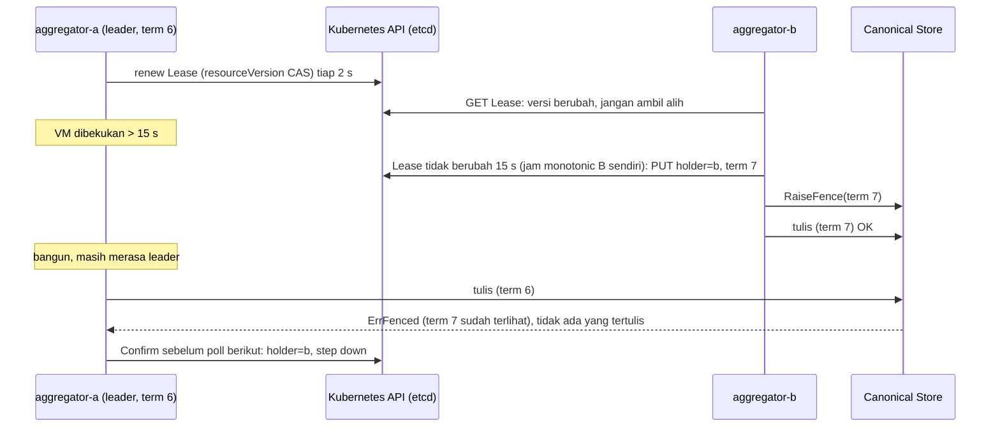

# Problem 2 — Dua Nakhoda, Satu Kapal (Orang 1; load test: Orang 2)

> Draf bagian laporan M2 (Markdown; laporan final dikompilasi ke PDF). Bukti: `make demo-m2-p2`
> (`docs/evidence/m2/p2-latest.log`), `bash scripts/demo/m2-single-writer.sh`, `bash scripts/demo/m2-freeze.sh`,
> `bash scripts/k8s/practice.sh clock-skew|kill-leader`, dan test `services/aggregator/internal/leader`,
> `internal/ports/repotest` (`runFence`).

## 1. Identifikasi masalah

| Kriteria | Persoalan | Nama dalam literatur |
|---|---|---|
| 2 | Tiga instance identik sama-sama menjalankan polling, sehingga setiap kejadian diambil dan dicatat tiga kali | *Leader election* / *mutual exclusion* terdistribusi; konsumsi *exactly-once* dari sumber pull |
| 4 | Pemegang tugas ditentukan dengan "masa berlaku" berbasis waktu, padahal jam tiap mesin bisa melompat (NTP mati, +45 s / −30 s) | *Clock skew* dan *clock drift*; tidak ada *global clock*; asumsi *bounded clock error* pada *lease* (Gray & Cheriton 1989) |
| 5 | Proses yang dibekukan (VM di-*suspend*, laptop ditutup) bangun dan melanjutkan pekerjaannya karena merasa masih pemimpin | *Process pause* (GC/VM pause) dan *zombie leader*; diatasi dengan *fencing token* (Kleppmann, *How to do distributed locking*, 2016; DDIA bab 8) |

Inti persoalan: di sistem terdistribusi tidak ada cara bagi sebuah proses untuk **tahu** bahwa ia masih pemimpin pada
saat ia menulis. Sebuah *lease* hanya memberi tahu bahwa ia pemimpin **ketika lease terakhir dibaca**. Jeda apa pun di antara
membaca dan menulis (GC, *suspend*, jaringan) membuka celah dua pemimpin.

## 2. Rancangan solusi

1. **Satu penulis lewat leader election** (`services/aggregator/internal/leader`). Semua instance melayani baca; hanya
   pemegang Lease `aggregator-ingest` yang menjalankan polling BMKG/PVMBG, relay outbox, dan retry dead letter.
   Implementasinya klien REST kecil ke API Kubernetes (tanpa client-go): `GET`, lalu `POST`/`PUT` dengan
   `resourceVersion` sebagai *compare-and-swap*, sehingga etcd yang mengurutkan semua perubahan.
2. **Term = token fencing.** Setiap pergantian pemegang menaikkan `leaseTransitions`. Konteks kerja leader membawa
   `ports.Fence{Name, Term, Holder}` dan setiap tulis ke store (`Save`, `SetCursor`, dead letter, status sumber) memeriksanya
   **di dalam transaksi yang sama** dengan tulisnya (`adapters/postgres/unprocessed.go`, `checkFence`): baris `fence` dikunci,
   term yang lebih kecil dari yang tersimpan ditolak (`ErrFenced`, transaksi di-*rollback*), term yang lebih besar menaikkan
   nilai tersimpan. Leader baru memanggil `RaiseFence` sebelum tulis pertamanya; karena kunci baris, tulis term lama yang
   sedang berjalan selesai lebih dulu, dan setiap tulis term lama sesudahnya ditolak.
3. **Gerbang sebelum memanggil upstream** (`Loop.Gate` = `Elector.Confirm`): sebelum setiap siklus poll, leader membaca ulang
   Lease. Leader yang baru bangun dari *freeze* langsung tahu ia sudah diganti dan mundur, jadi BMKG/PVMBG tidak menerima
   permintaan dari dua instance. Header `X-Caller` (nama pod) membuat hal ini terlihat di log upstream.
4. **Status sumber dibagi lewat store** (`PutSourceStatus`): instance yang tidak polling tetap memberi `freshness` yang benar.
   Umur status diukur dengan jam store; status yang tidak diperbarui > 30 s ditandai `unknown` + `stale_since`.
5. **Titik masuk dan rolling update** (`deploy/k8s/aggregator.yaml`): Service Kubernetes di depan ≥ 3 replika dengan
   `topologySpreadConstraints` (maxSkew 1 per node), `readinessProbe /ready` tiap 2 s (instance yang tidak bisa menjangkau store
   keluar dari Service setelah 4 s), `maxUnavailable: 0`, `preStop sleep 10`, dan *graceful shutdown*: permintaan yang sedang
   berjalan diselesaikan (konteks request tidak ikut dibatalkan SIGTERM), leader melepas Lease saat berhenti sehingga
   penggantinya mengambil alih dalam ±2 s, bukan 15 s.

## 3. Sumber kebenaran waktu (jawaban hint)

**Tidak ada jam yang dipercaya untuk keselamatan (safety).** Keputusan "siapa boleh menulis" diambil oleh store dari urutan
term, bukan dari waktu. Waktu hanya dipakai untuk **liveness** (kapan mengambil alih), dan itu pun tanpa membandingkan jam dua
mesin:

- Urutan perubahan Lease ditentukan oleh etcd (`resourceVersion`), satu tempat.
- Kandidat menganggap Lease kedaluwarsa bila objek Lease **tidak berubah** selama `LEASE_DURATION_SEC` menurut **jam monotonic
  kandidat sendiri**, dihitung sejak ia pertama kali melihat versi itu. `renewTime` di objek (ditulis dengan jam dinding
  pemegang) tidak pernah dibaca untuk keputusan. Jam dinding yang melompat +45 s / −30 s tidak menggeser jam monotonic.
- Leader berhenti sendiri bila gagal memperbarui selama `RENEW_DEADLINE` (10 s) < `LEASE_DURATION` (15 s), lagi-lagi dengan
  jam monotonic-nya. Selisih 5 s itu memastikan, selama laju jam kedua mesin wajar, leader lama sudah berhenti sebelum
  penerus boleh mengambil alih.
- Bila asumsi itu dilanggar (VM dibekukan: jam monotonic tidak berjalan), **fencing** di store tetap mencegah tulis ganda.
  Waktu tulis untuk audit (`outbox.stored_at`) diambil dari jam store, satu jam untuk semua penulis.

Kenapa aman pada kriteria 4: pergeseran jam tidak mengubah keputusan siapa pun (lihat
`TestSkewedHolderClockDoesNotCauseTakeover`, `TestClockJumpOnLeaderNodeKeepsSingleLeader`). Kenapa aman pada kriteria 5:
leader yang bangun memegang term lama; penerusnya sudah menaikkan fence, jadi semua tulisnya ditolak store, dan `Confirm`
membuatnya mundur sebelum poll berikutnya (`TestFrozenLeaderIsFencedAfterWakingUp`; di cluster: `scripts/demo/m2-freeze.sh`
memeriksa `SELECT count(*) FROM outbox WHERE writer_term = <term lama> AND stored_at > <awal freeze>` = 0).

## 4. Batas waktu dan trade-off

| Parameter | Nilai | Alasan dan trade-off |
|---|---|---|
| `LEASE_DURATION_SEC` | 15 s | Waktu ambil alih terburuk ≈ 15 s + 2 s (retry) + 3 s (siklus poll) ≈ 20 s, jauh di bawah 60 s. Lebih kecil = failover lebih cepat tetapi jeda GC / jaringan sesaat bisa memicu pergantian leader yang tidak perlu. |
| `LEASE_RENEW_DEADLINE_SEC` | 10 s | Leader menyerah 5 s sebelum orang lain boleh mengambil alih: margin untuk perbedaan laju jam. |
| `LEASE_RETRY_PERIOD_SEC` | 2 s | 5 kali kesempatan renew dalam satu deadline; beban API server ≈ 1 permintaan / 2 s per instance. |
| `Confirm` sebelum tiap poll | 1 GET Lease / siklus / sumber | Biaya kecil; menutup celah "bangun lalu langsung memanggil upstream". |
| Toleransi node `unreachable` | 20 s | Pod di node mati diganti setelah 20 s (bawaan 300 s). Terlalu kecil = pod dipindah karena gangguan jaringan singkat. |
| `SOURCE_STATUS_MAX_AGE_SEC` | 30 s | > durasi lease + beberapa siklus; status yang lebih tua berarti tidak ada yang polling. |
| readiness | tiap 2 s, gagal 2× | Instance tidak sehat keluar dari Service dalam ±4 s. |

## 5. Alternatif yang dipertimbangkan

| Alternatif | Ditolak karena |
|---|---|
| Lock di PostgreSQL (`pg_try_advisory_lock` / tabel lease dengan `now()` DB) | Mengikat koordinasi ke store yang di M2 di-*shard* dan node-nya boleh mati (P1); Lease di etcd hidup di control plane yang tidak dimatikan skenario. |
| client-go `leaderelection` | Benar secara konsep, tetapi menambah dependensi besar; perilakunya sama (CAS + jam monotonic). Kami tetap butuh fencing karena client-go sendiri menyatakan tidak menjamin satu leader saat proses dijeda. |
| Partisi kerja per sumber tanpa leader (hash sumber ke instance) | Tetap perlu kesepakatan keanggotaan; rebalancing saat skala 3 → 5 → 2 menimbulkan periode dua pemilik. |
| Idempotensi saja (biarkan tiga instance polling, dedup di store) | Store memang idempoten (hazard_id deterministik), tetapi upstream menerima permintaan berlipat (dilarang kriteria 2) dan versi hazard bisa saling timpa. |

## 6. Batasan yang disadari

- Fencing hanya melindungi unit penyimpanan yang **sudah melihat** term baru. `RaiseFence` menaikkan fence di semua unit
  sebelum tulis pertama; store ter-shard (P1, Orang 3) wajib menerapkan hal yang sama di setiap shard (kontrak di
  `docs/contracts.md` §9.2 dan `repotest`).
- Permintaan HTTP yang **sudah terkirim** ke upstream tepat sebelum proses dibekukan bisa selesai setelah penerus mulai; hasilnya
  tetap ditolak store. Log upstream mencatat waktu selesai, jadi yang dibuktikan adalah tidak ada dua caller yang aktif bersamaan
  setelah serah terima (lihat skrip `m2-single-writer.sh`).
- Lease bergantung pada control plane. Pada topologi 2 node, kehilangan control plane menghentikan pergantian leader (bukan
  layanan baca). Skenario wajib hanya mematikan worker.
- Relay outbox hanya di leader; selama serah terima (≤ 20 s) event menunggu di outbox, tidak hilang.
- Di cluster demo (2 VM VirtualBox di satu laptop), Canonical Store berada di node-b. Membekukan node-b berarti store ikut
  beku: penerus memegang lease selama freeze, tetapi baru bisa menaikkan fence dan menulis setelah node-b bangun. Pada
  `freeze.log`, pod yang bangun mundur (`leader_lost lease_taken`) sekitar 12 ms sebelum fence term baru tercatat, dan tidak
  pernah mencoba menulis. Jam store pada node yang dibekukan ikut berhenti, jadi `stored_at` hanya bermakna sebagai urutan.
  Selama freeze, API k3s di laptop ini sempat lambat. Akibatnya pengambilalihan bisa lebih lama dari 15 s: pada bukti, pemegang
  baru baru terlihat setelah 48 s, dan pada satu percobaan lain sekitar 100 s. Ini keterbatasan virtualisasi bersarang,
  bukan logika lease.

## 7. Bukti per kriteria

| Kriteria | Bukti |
|---|---|
| 1 | `demo-m2-p2` langkah 1: 3 pod, `topologySpreadConstraints`, endpoint siap per pod |
| 2 | langkah 2–4: satu leader; log BMKG/PVMBG per `caller` tidak pernah tumpang tindih; `count(*) = count(DISTINCT (source, source_ref_id))` |
| 3 | langkah 5–6: leader dihapus, penerus mengambil alih dalam 13 s (k3s), tidak ada event BMKG yang hilang, tanpa duplikat |
| 4 | `practice clock-skew` + `m2-single-writer.sh`: periode tulis per term (jam store) tidak tumpang tindih |
| 5 | `m2-freeze.sh` (VM node-b di-*pause* 48 s di k3s): term 33 → 34, 0 baris dari term 33 setelah freeze, pod yang bangun mencatat `leader_lost` lalu `ingestion_stopped` |
| 6–7 | load test (Orang 2) |
| 8 | langkah 8: `set image` k3s2 → k3s1 di bawah beban 4 klien paralel, 1 955 permintaan, 0 gagal (k3s 2 VM; `docs/evidence/m2/p2-latest.log`) |
