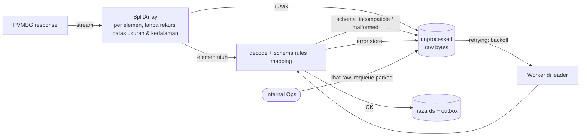

# Problem 3 — Surat dari Tetangga (Orang 1: kriteria 1–5; Orang 2: kriteria 6)

> Draf bagian laporan M2. Bukti: `make demo-m2-p3` (`docs/evidence/m2/p3-latest.log`), `make demo-p1` (M1, kini
> memakai dead-letter store), test `services/aggregator/internal/{sources,dlq,poller,mapping,api}`,
> `internal/ports/repotest` (`runUnprocessed`), dan `services/pvmbg-mock/internal/pvmbg/m2_test.go`.
> Bagian kriteria 6 (`POST /field-reports`) ditulis Orang 2.

## 1. Identifikasi masalah

| Kriteria | Persoalan | Nama dalam literatur |
|---|---|---|
| 2 | Pesan yang gagal diproses harus disimpan, bukan dibuang atau dicoba terus-menerus; kegagalan sementara harus dibedakan dari kegagalan permanen | *Dead letter queue / dead letter channel* (Hohpe & Woolf, *Enterprise Integration Patterns*); *transient vs permanent fault*, *retry with exponential backoff* |
| 3 | Satu pesan rusak (terpotong, bersarang sangat dalam, UTF-8 rusak, sangat besar) membuat parser gagal atau proses kehabisan memori, lalu restart berulang dan memblokir pesan lain | *Poison message / poison pill*; *head-of-line blocking*; *crash loop* |
| 4 | Setelah sistem disesuaikan, pesan lama diproses ulang: tidak boleh ganda dan tidak boleh menimpa data yang lebih baru | *Replay / reprocessing* dengan *idempotent consumer*; *per-key ordering* (*ordered delivery per entity*) |
| 1 | Skema mitra berubah tanpa koordinasi; sistem harus tahu mana yang boleh diterima | *Schema evolution*, *tolerant reader* (Fowler), kompatibilitas *backward/forward* |

## 2. Kebijakan perubahan skema (kriteria 1)

Kebijakan M1 dipertahankan dan dinyatakan di komentar paket `services/aggregator/internal/mapping/raw.go`:

| Perubahan | Sikap | Alasan |
|---|---|---|
| Field baru (tipe apa pun) | **diterima otomatis** → `attributes` | Tidak mengubah arti field kanonik; tidak ada data yang dibuang |
| Field non-kanonik hilang atau berganti tipe | **diterima otomatis** | Disimpan apa adanya di `attributes`; tidak ada aturan pemetaan yang bergantung padanya |
| Urutan / format field | **diterima otomatis** | Record dibaca sebagai peta, bukan posisi |
| Field kanonik di-*rename*, dihapus, dipindah, atau berganti tipe; nilai enum baru | **tidak diterima** → *parked* `schema_incompatible` | Menebak arti sama dengan risiko severity atau lokasi yang salah pada peringatan bencana |
| Byte yang tidak bisa dibaca | **tidak diterima** → *parked* `malformed` (*retrying* bila terpotong di jalan) | Tidak ada isi yang bisa dipetakan |

Mock PVMBG mendapat mode baru di `POST /admin/schema-version` (`{"mode":"incompatible"}` / `{"version":3}` / pilihan
`{"incompatible":["rename","type_change","drop_required"]}`): `alert_level` → `level`, `reported_at` ISO → angka Unix,
`volcano_id` hilang (kodenya pindah ke `location.volcano_code`). Laporan lama tetap berbentuk lama, seperti versi API baru
di dunia nyata. `POST /admin/malformed` membuat pesan rusak.

## 3. Mekanisme

1. **Membaca tanpa bisa dijatuhkan** (`sources/split.go`). Respons dibaca sebagai *stream* dan dipecah per elemen array tanpa
   di-*decode*: kedalaman dihitung dengan penghitung (tanpa rekursi), satu elemen paling banyak `MESSAGE_MAX_BYTES` (1 MiB)
   ditahan di memori, UTF-8 diperiksa eksplisit (`encoding/json` diam-diam mengganti byte rusak dengan U+FFFD). Elemen rusak
   dikembalikan bersama masalahnya; elemen di sekitarnya tetap diproses. Tidak ada `panic` yang mungkin dari input.
2. **Dead-letter store** (`internal/dlq`, tabel `unprocessed` di Canonical Store). Setiap pesan gagal disimpan dengan **byte
   persis** yang diterima, `reason`, `source`, `received_at`, `kind`, `record_key`, `attempts`, `status`. `message_id` =
   sha256(source, kind, bytes), jadi pesan yang diambil ulang oleh jendela overlap polling tidak tersimpan dua kali.
3. **Dua perlakuan berbeda** (kriteria 2):
   - *retrying* (`retryable: true`): kegagalan yang bisa hilang sendiri — tulis ke store gagal, peringatan tsunami yang
     event-nya belum datang (`dependency_missing`), elemen terpotong di jalan (sumber dipoll ulang dari watermark yang sama).
     Worker di leader mencoba ulang dengan *exponential backoff* 2 s … 120 s, maksimum 8 kali, lalu *parked*
     `retry_exhausted`. Elemen terpotong selesai sendiri begitu record utuhnya tersimpan.
   - *parked* (`retryable: false`): `schema_incompatible` dan `malformed`. **Tidak pernah dicoba otomatis** (mencoba lagi
     byte yang sama dengan kode yang sama pasti gagal). Menunggu perubahan sistem lalu *requeue* oleh Internal Ops.
4. **Watermark tidak tertahan pesan buruk**: kursor polling maju melewati pesan yang sudah aman di dead-letter store, sehingga
   satu pesan rusak tidak membuat sumber diambil ulang terus (head-of-line blocking).
5. **Penyesuaian sistem tanpa kode baru** (`mapping/rules.go`): aturan deklaratif per sumber — `rename` (termasuk path
   bersarang) dan `coerce` (`unix_seconds_to_rfc3339`, `number_to_string`, …) — dimuat dari ConfigMap
   `aggregator-schema-rules`. Aturan hanya **mengisi field kanonik yang kosong**, jadi record skema lama tidak berubah. Aturan
   tidak valid menghentikan start-up (pod tidak Ready, rollout berhenti), bukan diabaikan diam-diam. Contoh penyesuaian
   PVMBG v3: `deploy/schema-rules/pvmbg-v3.json`.
6. **Pemrosesan ulang** (kriteria 4): `POST /internal/ops/unprocessed/reprocess` memindahkan pesan *parked* ke *retrying*.
   Worker memprosesnya dengan **kode yang sama** dengan jalur normal (`PVMBGSource.process`), urut kedatangan (`seq`).
   - *Tanpa duplikat*: `hazard_id` deterministik dan `Upsert` idempoten; pesan yang ternyata sudah tersimpan menghasilkan
     `unchanged`.
   - *Urutan per `source_ref_id`*: selama ada pesan terbuka untuk record yang sama (sumber + kind + `record_key`), pesan baru
     record itu ikut masuk antrean dengan alasan `ordered_after: <id>` dan worker hanya memproses pesan terdepan per record.
     Pesan lama yang pulih tidak bisa menimpa data yang lebih baru (`TestIncompatibleChangeRecoversAfterAdjustmentInOrderWithoutDuplicates`:
     VR-1 v1 diproses sebelum v2, hasil akhir AWAS v2).
7. **Hanya Internal Ops** (kriteria 5): `/internal/ops/*` hanya menerima `Authorization: Bearer <AGGREGATOR_OPS_TOKEN>`.
   Kredensial Client-Facing API (`X-Service-Key`) dan token auditor ditolak (401/403). Auditor mendapat
   `/internal/audit/unprocessed` (Lampiran A) yang hanya memuat metadata, tanpa isi pesan. `GET /internal/quarantine` M1, yang
   terbuka untuk service key, dihapus.

## 4. Alternatif yang dipertimbangkan

| Alternatif | Konsekuensi |
|---|---|
| Buang pesan buruk dan catat di log | Melanggar kriteria 2; isi tidak bisa diproses ulang |
| DLQ sebagai topic Kafka | Wajar untuk alur push, tetapi butuh konsumen DLQ, penyimpanan status, dan akses terkontrol tambahan; tabel di store yang sudah dimiliki Aggregator memberi query, status, dan transaksi dengan fencing tanpa komponen baru |
| Retry semua kegagalan dengan backoff | Pesan rusak permanen mengisi antrean retry selamanya dan menyamarkan masalah nyata |
| Coba tebak (`level` mungkin `alert_level`) | Cepat, tetapi tebakan salah pada peringatan bencana lebih berbahaya daripada keterlambatan; penyesuaian tetap butuh keputusan manusia |
| Parser JSON standar untuk seluruh respons | Satu elemen buruk menggagalkan seluruh batch; kedalaman ekstrem dan ukuran besar memakan memori |

## 5. Batasan yang disadari

- Pesan melebihi `MESSAGE_MAX_BYTES` disimpan **1 MiB pertama** + ukuran aslinya (bukan "utuh"), agar satu pesan tidak bisa
  menghabiskan memori atau tabel. Pesan seperti itu tidak bisa dipulihkan dengan aturan skema; perlu perubahan batas.
- Watermark hanya maju oleh record yang waktunya bisa dibaca. Bila sumber mengubah tipe `reported_at`, record baru diambil
  ulang tiap siklus sampai aturan dipasang (tidak ganda karena `message_id`), dengan biaya bandwidth.
- Elemen terpotong tanpa `report_id` yang terbaca tidak bisa dikaitkan dengan record utuhnya; ia di-*parked*
  `retry_exhausted` setelah 8 percobaan (datanya sendiri tetap masuk dari respons berikutnya).
- Aturan skema hanya `rename` dan `coerce`. Perubahan makna atau satuan butuh kode baru (versi Aggregator baru, rolling
  update tanpa downtime, lalu requeue — jalurnya sama).

## 6. Bukti per kriteria

| Kriteria | Bukti |
|---|---|
| 1 | `demo-m2-p3` langkah 1 (field baru diterima) dan 4 (perubahan tidak kompatibel di-*parked*) |
| 2 | langkah 2: `too_deep`, `invalid_utf8`, `too_large` *parked* (attempts tetap), elemen terpotong *retrying* → *resolved* sendiri |
| 3 | langkah 2: restart count Aggregator tidak berubah, laporan valid yang dikirim bersama pesan rusak tersimpan |
| 4 | langkah 5: aturan PVMBG v3 dipasang lewat rolling update, requeue, ketiga laporan tersimpan, `count(*) - count(DISTINCT source_ref_id) = 0` |
| 5 | langkah 3: `X-Service-Key` 401, service key sebagai Bearer 403, token audit 403, token Ops 200 |
