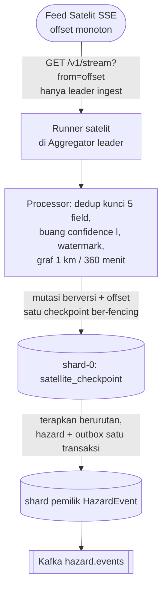

# Problem 4: Atap Seng di Siang Bolong

## 1. Identifikasi masalah (butir "Di laporan" 1)

| Kriteria | Persoalan yang sebenarnya terjadi | Nama dan konsep dalam literatur |
|---|---|---|
| 2. Pengelompokan menurut waktu deteksi, keterlambatan | Data tiba tidak berurutan dan terlambat. Urutan tiba di BNPB tidak sama dengan urutan lintasan satelit, dan sebagian laporan lintasan pagi baru tiba siang. Pengelompokan yang memakai waktu tiba akan memisahkan deteksi yang seharusnya satu kebakaran. | *Event time vs processing time*, *out-of-order / late data*, **watermark** dan *allowed lateness* (Dataflow Model, Akidau dkk. 2015, Streaming Systems). Pengelompokan berdasarkan kedekatan ruang dan waktu adalah *session-like windowing* atas graf (*connected components*, mirip DBSCAN dengan `minPts = 2`). |
| 4. Lonjakan 60×, tanpa kehilangan, kembali mutakhir ≤ 60 s | Laju masuk sesaat melebihi laju olah. Bila tidak ada buffer yang tahan lama dan posisi baca yang tersimpan, data hilang atau sistem tertinggal tanpa terlihat. | *Backpressure*, **consumer lag**, *log-based messaging* dengan offset (Kleppmann, DDIA bab 11), *catch-up* setelah *burst*. |
| 5. Pemroses mati di tengah pengenalan kebakaran | Keadaan sementara (anggota graf, ID kebakaran, mutasi yang belum diterapkan) hilang bila hanya ada di memori. Pengulangan setelah restart juga bisa menggandakan hasil. | **Exactly-once processing / effectively-once**: *checkpointing* keadaan bersama offset (Chandy–Lamport, Flink), **idempotent sink** dengan versi, *at-least-once delivery + deduplication*. |

## 2. Mengapa polling M1 ditinggalkan untuk sumber ini (butir "Di laporan" 2)

Pola M1 adalah *polling* dengan *cursor* waktu dan *overlap*. Pola ini cocok untuk BMKG dan PVMBG: datanya sedikit,
setiap record berdiri sendiri, dan pengambilan ulang dengan overlap aman karena upsert idempoten. Untuk Feed Satelit
pola itu ditinggalkan, karena:

1. **Feed sudah berupa log berurutan.** Setiap kejadian punya offset yang naik monoton tanpa celah, dan stream dapat
   dilanjutkan dengan `from=<offset>` atau `Last-Event-ID`. Posisi baca yang tepat adalah satu bilangan. Cursor waktu
   tidak bisa menangkap `update` dan `retract`, karena keduanya merujuk ke deteksi lama.
2. **Lonjakan ribuan deteksi per lintasan.** Polling setiap beberapa detik menambah latensi sebesar interval dan
   membuang permintaan saat feed diam. SSE mendorong data begitu tersedia. Heartbeat memberi tanda hidup dan ikut
   memajukan offset.
3. **Batas koneksi.** Feed menolak koneksi berlipat (`429 too_many_connections`). Dengan satu koneksi SSE milik
   leader ingest (mekanisme P2), feed hanya dibaca sekali oleh seluruh sistem.

Yang **dipertahankan** dari M1: satu penulis ber-fencing (lease Kubernetes, P2), penyimpanan idempoten dengan versi,
dan outbox → Kafka untuk konsumen hilir.

## 3. Rancangan

### 3.1 Dari deteksi ke HazardEvent WILDFIRE (kriteria 1, 3)

- **Identitas deteksi.** Kunci `satellite|acq_date|acq_time|latitude|longitude` diambil *apa adanya* dari teks feed,
  termasuk nol di depan dan di belakang. Untuk perhitungan, waktu dan koordinat di-parse terpisah. Deteksi dengan kunci
  sama yang tiba ulang diabaikan.
- **Waktu deteksi** adalah `acq_date + acq_time` dalam UTC, bukan waktu tiba.
- **Confidence `l`** tidak ikut dikelompokkan. Deteksinya tetap disimpan sebagai *inactive*, supaya `update` yang
  menaikkan confidence-nya tetap bisa diterapkan.
- **Keterhubungan.** Dua deteksi terhubung bila jaraknya ≤ 1,0 km (haversine) **dan** selisih waktunya ≤ 360 menit.
  Calon tetangga dicari lewat grid sel ECEF 1 km × 6 jam, lalu jarak dihitung tepat. Komponen terhubung (BFS) dengan
  ≥ 2 deteksi menjadi satu kebakaran, termasuk bila deteksinya dari satelit berbeda. Deteksi tunggal dihitung dan
  dilaporkan (`singletons`).
- **Pemetaan.** `occurred_at` = deteksi paling awal, `latitude/longitude` = centroid sferis, `area_name` = provinsi
  dengan titik pusat terdekat pada tabel statis (`SATELLITE_PROVINCES_PATH`). Severity: AWAS bila ≥ 20 deteksi atau
  FRP ≥ 100 MW, SIAGA bila ≥ 6 deteksi atau ≥ 30 MW, selain itu WASPADA. `attributes` berisi `detection_count`,
  `satellites`, `max_confidence`, `total_frp_mw`, dan `detection_keys` yang terurut.
- **ID stabil.** `source_ref_id` diturunkan dari identitas sesi feed, offset tempat komponen pertama kali memenuhi
  syarat, dan kunci anggota awalnya. Memproses ulang aliran yang sama menghasilkan ID yang sama. Pada `update` biasa
  ID tidak berubah. Saat dua kebakaran bergabung, ID penyintas dipilih secara deterministik. Saat kebakaran menyusut di
  bawah dua deteksi atau ditarik (`retract`), HazardEvent yang **sama** mendapat versi baru `retired`. Tidak dibuat
  event baru, dan event `retired` tidak dihitung lagi oleh Audit API.

### 3.2 Kapan kebakaran "selesai dikenali" dan bagaimana keterlambatan ditangani (butir "Di laporan" 3)

Kebakaran **tidak menunggu jendela ditutup** untuk diterbitkan. Begitu sebuah komponen memiliki dua deteksi, HazardEvent
langsung disimpan. Setiap deteksi, `update`, atau `retract` berikutnya menghasilkan versi baru dari HazardEvent yang
sama. Cara ini menjaga latensi rendah, karena peringatan tidak tertahan oleh *allowed lateness*. Konsekuensinya,
konsumen melihat beberapa versi dari satu kebakaran.

Sebuah kebakaran dianggap **final** ketika watermark melewati deteksi terakhirnya ditambah 360 menit. Sejak itu tidak
ada deteksi baru yang sah yang masih bisa tersambung.

- **Watermark** = waktu akuisisi terbesar yang pernah dilihat − `SATELLITE_LATENESS_SEC` (24 jam).
- **Deteksi baru di bawah watermark** tidak digabungkan ke kebakaran. Deteksi itu ditandai *late*, dicatat di
  checkpoint, dan jumlahnya dilaporkan di `/internal/satellite/status`, metrik `satellite_late_detections`, dan
  dashboard. Deteksi itu tidak dibuang diam-diam.
- **Koreksi eksplisit** (`update`/`retract`) terhadap deteksi yang sudah diterima tetap diproses kapan pun tibanya.

**Pemilihan batas 24 jam berdasarkan pengukuran.** `tools/satellite/probe.py` membaca 22.250 event practice
(20.676 deteksi) dan mengukur jarak *out-of-order*. Jarak ini adalah waktu akuisisi terbesar yang sudah terlihat
dikurangi waktu akuisisi deteksi itu, persis besaran yang dibandingkan watermark. Hasilnya p50 5 menit, p95 64 menit,
p99 202 menit, dan **maksimum 246 menit** (`docs/evidence/m2/p4-lateness-probe.log`). Batas 24 jam memberi margin
sekitar 5,8× terhadap maksimum yang teramati.

*Trade-off.* Keadaan tidak dipangkas oleh watermark: semua deteksi tetap disimpan agar koreksi lama tetap bisa
diterapkan. Batas yang lebih kecil (misalnya 6 jam) tidak menghemat memori dalam rancangan ini. Batas itu hanya
menambah risiko deteksi sah tergolong terlambat bila profil ujian lebih berantakan dari practice.

### 3.3 Di mana keadaan sementara disimpan (kriteria 5)

Seluruh keadaan pemrosesan disimpan sebagai satu dokumen checkpoint di tabel `satellite_checkpoint` pada shard-0
(metadata). Isinya: deteksi, keanggotaan, penugasan ID, offset terbaca, offset `applied`, hitungan terlambat dan
ditolak, serta daftar mutasi berversi yang belum diterapkan. Shard-0 direplikasi sinkron ke node lain (P1) dan setiap
tulisannya diperiksa fence (P2).

Urutan per batch:
1. Kejadian dibaca dan diterapkan ke processor di memori, sehingga mutasi `Pending` bertambah.
2. Checkpoint **dengan** daftar `Pending` ditulis lebih dulu (durable).
3. Setiap mutasi disimpan ke shard pemiliknya dengan versi yang diharapkan. HazardEvent dan baris outbox masuk dalam
   satu transaksi. Versi yang sudah ada dilewati (idempoten) setelah *WAL barrier* memastikan versi itu durable.
4. Setelah semua mutasi tersimpan, `Pending` dikosongkan dan `applied` = offset terbaca, lalu checkpoint ditulis lagi.

Bila proses mati di antara langkah mana pun, instance yang menjadi leader berikutnya memuat checkpoint, menerapkan sisa
`Pending`, lalu membuka stream dari offset tersimpan. Hasil akhirnya sama dengan pemrosesan tanpa gangguan: tidak ada
mutasi hilang (sudah durable sebelum diterapkan) dan tidak ada yang ganda (versi + idempotensi).

Checkpoint ditulis paling sering sekali per detik atau setiap 512 event. Dokumen checkpoint berisi seluruh keadaan
sesi, sehingga menulisnya per event akan membuat lonjakan 60× tertinggal.

### 3.4 Putus dan menyambung (kriteria 8)

Stream dibuka dari offset tersimpan (inklusif). Event pertama yang sudah dilihat dilewati. Bila offset berikutnya tidak
tepat +1, koneksi dianggap rusak dan dibuka ulang dari posisi terakhir, sehingga tidak ada celah. Kegagalan jaringan,
idle 45 s, 429, dan 503 diulang dengan *exponential backoff + jitter* (1–30 s). Error 400/401/403 diulang tiap 30 s dan
dicatat sebagai kesalahan konfigurasi.

Event yang isinya tidak dapat diterapkan (JSON rusak, nilai tidak valid, `update` untuk deteksi yang tidak pernah
terlihat) **dicatat beserta teks mentahnya dan dilewati**, dengan offset tetap maju. Prinsipnya sama dengan P3: satu
pesan rusak tidak boleh menghentikan seluruh aliran. Jumlahnya ada di `rejected_events` dan metrik
`satellite_events_rejected_total`. Uji: `TestBrokenEventsAreSkippedWithoutStallingTheFeed`.

### 3.5 Sesi practice vs ujian

Sesi practice yang panjang sudah berada di offset ±5,55 juta. Tanpa checkpoint, consumer akan membaca ulang dari 0 dan
tidak pernah mutakhir. Karena itu `SATELLITE_START_FROM=latest` membuat sesi practice baru mulai dari head. Profil
`exam` **selalu** dibaca dari offset 0, karena seluruh alirannya dibandingkan dengan referensi asisten. Kunci checkpoint
memuat identitas sesi, sehingga sesi ujian tidak tercampur dengan practice.

## 4. Alternatif yang dipertimbangkan

| Alternatif | Konsekuensi | Keputusan |
|---|---|---|
| Polling `/v1/stream` berkala (pola M1) | Latensi sebesar interval, permintaan berulang, update/retract sulit diurutkan | Ditolak (lihat §2) |
| Tumbling window per lintasan, terbit setelah jendela ditutup | Hasil final sekali terbit, tetapi peringatan tertahan sebesar lateness (jam) dan kebakaran yang melintasi batas jendela terpotong | Ditolak, dipakai pembaruan inkremental berversi |
| Stream processor terpisah (Kafka Streams/Flink) dengan state store | Checkpoint dan exactly-once bawaan, tetapi butuh komponen dan memori baru di cluster 2 node (Lampiran B) | Ditolak untuk PoC, prinsip yang sama (checkpoint + sink idempoten) diterapkan di Aggregator |
| Simpan setiap deteksi sebagai baris dan kluster di SQL | Recovery sederhana, tetapi query tetangga lintas shard per event mahal saat 60× | Ditolak, keadaan graf di checkpoint metadata |

## 5. Jaminan pemrosesan (butir "Di laporan" 4)

**Effectively-once.** Setiap event feed memengaruhi hasil tepat satu kali walaupun dibaca lebih dari sekali:
- **Sumber:** at-least-once, karena resume inklusif dan pembacaan ulang setelah crash.
- **Sink:** idempoten dengan versi per HazardEvent.
- **Keadaan:** checkpoint bersama offset.

Ke Kafka, outbox menerbitkan at-least-once dengan `event_id = hazard_id:version`, dan konsumen menghapus duplikat
dengan kunci itu. Bukti ada di §6.

## 6. Bukti per kriteria

| Kriteria | Bukti | Hasil |
|---|---|---|
| 1. WILDFIRE lintas satelit, satu kebakaran satu HazardEvent | `TestInclusiveResumePreservesOffsetsAndRetiresOriginalHazard` (dua satelit N20/N21 → satu kebakaran SIAGA, `detection_keys` apa adanya), replay capture practice 1.027 frame → 17 kebakaran aktif (`p4-practice-dev.log`), consumer di leader cluster demo membaca feed practice live, Audit `SATELIT` naik dari 8 menjadi 400 HazardEvent selama gladi 22 Nov (`p1-recovery-observed.log`) | **PASS** (uji + live) |
| 2. Waktu deteksi, batas keterlambatan, deteksi terlambat tidak dibuang diam-diam | `p4-lateness-probe.log` (out-of-order maks. 246 menit, batas 24 jam), hitungan `late_detections` di checkpoint, `/internal/satellite/status`, metrik `satellite_late_detections` | **PASS** |
| 3. Update/retract memperbarui event yang ada | uji yang sama: `update` menaikkan confidence/FRP pada versi 1, `retract` menghasilkan versi 2 `retired` dari HazardEvent yang sama, Audit tidak lagi menghitungnya | **PASS** (uji) |
| 4. 60×: tidak hilang, mutakhir ≤ 60 s, p95, ketertinggalan di dashboard | profil practice berjalan 60× (`speed=60` di `/v1/session`), panel Grafana "P4 Feed Satelit" (head vs applied, lag, p50/p95 masuk → tersimpan), replay tanpa pembatasan laju di kind: p95 597 ms | **Sebagian**: angka catch-up dan p95 dari sesi ujian ditunjukkan di video |
| 5. Pemroses mati saat kebakaran sedang dikenali → hasil sama | `TestPendingChangesResumeAfterPartialApply` (crash di tengah daftar mutasi, versi outbox tetap unik), failover leader P2 berlangsung saat feed berjalan tanpa HazardEvent ganda (`p2-latest.log`, "no duplicates") | **PASS** (uji + failover) |
| 6. Bandingkan dengan referensi asisten | metode §5, referensi baru tersedia di sesi ujian | ➡️ |
| 7. Feed live beberapa menit | lihat kriteria 1 | **PASS** |
| 8. Putus dan menyambung tanpa hilang/ganda | resume inklusif dari offset tersimpan (uji resume), event rusak dilewati tanpa macet (`TestBrokenEventsAreSkippedWithoutStallingTheFeed`), `satellite_stream_disconnected` lalu lanjut dari offset tersimpan saat fence timeout di freeze P2 | **PASS** |

## 7. Batasan yang disadari

- **Checkpoint penuh.** Ukurannya tumbuh seiring jumlah deteksi sesi. Untuk sesi berjam-jam ini cukup. Untuk berhari-hari
  dibutuhkan checkpoint inkremental atau pemangkasan deteksi yang sudah final.
- **Latensi diukur dari penerimaan lokal** (`received`) sampai HazardEvent tersimpan. Antrean di jaringan sebelum socket
  dibaca tidak ikut terukur.
- **Tabel provinsi** memakai titik ibu kota provinsi sebagai pusat, karena tabel acuan BNPB tidak tersedia. Kebakaran di
  dekat batas provinsi bisa diberi provinsi tetangga.
- **Perbandingan dengan referensi asisten** hanya dapat dilakukan pada sesi ujian. Skrip dan metodenya siap, hasilnya
  ditunjukkan di video.
